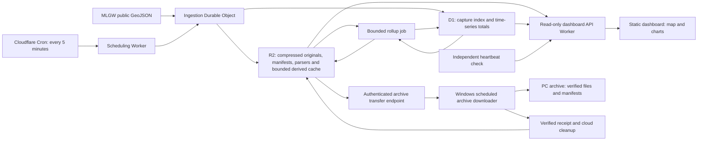

# MLGW outage history and dashboard: design plan

Prepared September 16, 2026; reconciled with the implementation and deployment state on September 17, 2026. See [current status and the documentation index](reports/PROJECT_STATUS.md) for dated runtime checks, completed work and remaining steps. Editing this plan does not start collection, deploy resources, install tasks, or authorize an additional implementation stage.

**Current scope as of September 17:** collection, validation and the dashboard run locally. The user explicitly requested a replacement Cloudflare Quick Tunnel, which was deployed behind the existing password gateway and verified; its eight-hour session expires September 17 at 1:57:53 PM CDT. This does not change the planned production audience or authorize permanent cloud deployment. Local Phases 1–2 trials are underway and the Phase 3 dashboard, historical heatmap and Census per-capita maps are implemented. Phase 3A source/cache, single-capture weather, numeric accumulation/spatial weighting and prepared 24/48/72-hour rainfall controls are implemented. Broader weather validation and weather/outage comparisons remain planned. Cloud compute/storage validation and desktop transfer/cleanup remain deferred until requested. Use `npm run preview:status` rather than this dated paragraph to determine whether a preview is still running.

**Access update:** the user subsequently requested tunnel closure. The September 17 supervisor and tunnel processes were verified stopped at 7:29:59 AM CDT / 12:29:59 UTC with reason `owner_requested`, before their scheduled expiry. The local dashboard remained healthy; no replacement session was started.

## 1. Recommended approach

The original production candidate is a small TypeScript application on Cloudflare: scheduled compute collects MLGW's public GeoJSON feed, R2 stores historical snapshots, D1 stores compact time-series summaries, and a static dashboard displays a map and charts. The local implementation uses Node, filesystem archives and SQLite. Phase 1 measurements favor testing a Durable Object for ingestion compute and compressed originals with a bounded normalized cache; the ordinary Worker-only design has not passed its resource gate. Keep the parser and analytics portable.

Start with **five-minute collection**, with a configurable one-minute option after measuring the source's actual update frequency. Keep detailed observations indefinitely where practical. Retain them in the cloud while space permits; under storage pressure, transfer detail older than one year to this Windows PC, verify it, and then remove only those verified cloud copies. Keep the newest year in cloud storage and long-term summaries available to the dashboard.

The dashboard will be **accessible to anyone with its link**, with light expected use. **Prioritize $0 recurring cost.** Cloudflare remains the first implementation candidate, subject to storm-load and compression tests. If free Workers compute is insufficient, evaluate free-tier compute alternatives before considering a paid plan; no paid upgrade is assumed.

The useful first version answers:

- How many customers and reported outages are affected now?
- How has that changed over the last day, week, or month?
- Where are the current outages, and what did the map show earlier?
- Which increases, long-running outages, or recurring locations warrant a closer look?

The weather extension will also answer:

- Where was precipitation occurring as outages appeared, and how much rain fell during and before that period?
- Which areas had more newly reported outages or greater observed interruption burden during heavy rain, prolonged rainfall, high winds, flash-flood episodes, snow, ice and heat waves?
- Do those associations persist across comparable events, weather exposure and population denominators, with missing observations and source-format changes visible?

### Confirmed requirements and remaining setup choices

The audience, retention intent, cost priority, and 30-day offline-PC allowance below reflect the user's September 16 clarifications. Local implementation status is recorded separately from future production requirements; cloud deployment and Windows-task installation remain deferred implementation steps.

| Decision | Requirement or selected approach | Implementation implication |
| --- | --- | --- |
| Audience | Anyone with the link; mostly personal use | No viewer login. Cache public reads, bound traffic, and keep administrative/archive operations authenticated. An unlisted URL does not enforce privacy. |
| History | Preserve detail as long as possible; newest year always in the cloud | Move older detail to the PC only when storage pressure warrants it; verify local receipt before cloud deletion. |
| Cloud provider | No preference; prioritize free | Start by validating Cloudflare; select another free-tier compute option if necessary. |
| Budget | Free-first; no paid compute commitment | Measure compressed annual storage and storm processing before launch; do not enable paid upgrades automatically. |
| Scope | All reported MLGW electric outages; anomalies, historical heatmap, Census per-capita maps and prepared weather/rainfall views | Extend the implemented local weather replay with broader validation in Phase 3A and condition comparisons in Phase 5. Automated notifications remain optional. |
| Validation and access now | Local validation; separately requested password-protected Cloudflare Quick Tunnel deployed September 17 | Weather work can run locally. Keep the requested session's expiry. Further sessions require a request; permanent cloud hosting/collection and persistent public access remain deferred. |
| Weather scope | Radar, rainfall accumulation and historical conditions including flash flood, prolonged rain, snow, ice and heat | Include wind alongside rain; distinguish measurements, warnings, reported events and derived condition labels. Start with radar/rainfall, then comparative analysis. |
| Desktop setup | PC is on irregularly; reserve at least 30 days of offline headroom | Size the reserve from projected storage growth, including storm periods. The provisional archive folder is `C:\Developer\mlgw-outage-scraper\archive`; recheck capacity for Phase 4B. |

## 2. Source discovery: what is already verified

Direct requests to the live map and its feed succeeded during this planning session. The map itself points to the GeoJSON URL; no login, browser automation, or map-tile extraction was needed.

| Source | Verified observation |
| --- | --- |
| [MLGW outage-map page](https://outagemap.mlgw.org/OutageSummary.php) | Loads `geojson.php` into an ArcGIS GeoJSON layer. Its JavaScript sets a 900-second page-refresh timer. It renders individual features and clusters them in the browser. |
| [MLGW GeoJSON feed](https://outagemap.mlgw.org/geojson.php) | Returns a JSON `FeatureCollection` with point coordinates and outage properties. The inspected response contained 15 features totaling 290 affected customers. This is one observation, not a sizing forecast. |
| [MLGW map description](https://www.mlgw.com/outagemap/) | Describes general outage information across Shelby County, based on reported and known outages; exact address details are deliberately unavailable. |

Observed field mapping:

| Source field | Proposed interpretation |
| --- | --- |
| `OUTAGE_NO` | Source outage identifier; store as a string |
| `CUR_CUST_AFF` | Currently affected customer count |
| `TIME_STAMP` | Reported start time, as labeled by the map popup |
| `EST_REPAIR_TIME` | Estimated restoration time; sometimes empty |
| `DURATION` | Source duration text; preserve, but calculate analytic durations from timestamps |
| `STATUS`, `IMPACT` | Source status and qualitative affected-area description |
| `geometry.coordinates` | Longitude, latitude; preserve the original GeoJSON |
| Feature `id` | Small sequential numbers in the sample; do not use for cross-snapshot identity |
| `OUT_CAUSE` | Present, often blank, and omitted from the map's visible popup; exclude from the initial dashboard |

The sample had no top-level feed update timestamp and no `ETag` or `Last-Modified` response header. The HTML page's “current as of” text must not automatically be treated as the GeoJSON's publication time. The outage host's `robots.txt` returned 404; that does not establish a reuse license.

Before production, check applicable source terms and any published collection guidance, and document the endpoint contract. Use a contactable application User-Agent, low request volume, and backoff. If access becomes restricted, stop and reassess the supported source. No customer-account access is needed.

**Unverified for the current feed:** publication cadence, outage-ID stability/reuse, coordinate precision, and completeness during storms. New-feed history starts with collection. The earlier scraper provides a separate historical source, described below; missing observations cannot be reconstructed.

### Historical evidence from the earlier scraper

Inspected [jpbranson/mlgw.outage.3 at revision `ea0c830`](https://github.com/jpbranson/mlgw.outage.3/tree/ea0c8309337171b398ffadd5d6105d997f9b354b). Analysis used its consolidated R data and the complete current file tree, plus one saved page/event pair. It did not scan every historical Git commit or establish all-time MLGW storm maxima.

| Measurement | Result | Design implication |
| --- | --- | --- |
| Consolidated event records | 1,997,747 rows; 53,274 distinct observation timestamps across 806 dates, February 8, 2022–February 20, 2025 | Existing history can seed storm comparisons; these are repeated event observations, not two million unique outages. |
| Largest recorded affected-customer total | **117,861**, June 26, 2023; 601 reported outages in that observation | Charts and anomaly rules must handle large changes in customer count independently of feature count. |
| Largest recorded outage total | **3,998**, February 8, 2022; 45,382 affected customers | Use about 4,000 current-format features as an observed-scale stress case, plus 10,000 for headroom. |
| Event rows at the largest outage total | 4,094 rows, but 3,998 distinct extracted event identifiers | Legacy imports must deduplicate within a capture and must not use raw row count as the outage total. |
| Recent saved snapshot files | 20,934 files forming 10,467 timestamp pairs, September 11, 2024–February 20, 2025; **38.86 MB combined** | Compressed historical storage is encouraging, but covers a different format and a limited date range. |
| Bytes per recent compressed pair | Mean 3.71 KB; median 3.49 KB; 95th percentile 5.13 KB; maximum 17.95 KB | Compression should be measured early in the new design. These are not new GeoJSON payload estimates. |
| Largest saved page in that recent tree | September 12, 2024: 114,121 bytes of extracted page text, stored as a 12,948-byte RDS; associated page summary: 20,793 customers / 293 outages | A concrete storm fixture for legacy parsing, separate from the larger storms in consolidated history. |
| Filename-based capture spacing in that recent tree | Median 17.2 minutes; 95th percentile 41.1 minutes; about 64% of intervals exceeded 15 minutes | The recorded archive does not deliver consistent 15-minute sampling. This is an observation of stored files, not proof that scheduler delay alone caused every gap. |

Method: extract one unique `(time, outage_num, cust_affected)` summary per timestamp from [`total_outages.rds`](https://github.com/jpbranson/mlgw.outage.3/blob/ea0c8309337171b398ffadd5d6105d997f9b354b/total_outages.rds); never sum its repeated customer totals. For file sizes, pair `.RData` and `_txt.rds` by filename timestamp in the [saved data directory](https://github.com/jpbranson/mlgw.outage.3/tree/ea0c8309337171b398ffadd5d6105d997f9b354b/data). File gaps use local filename times and are approximate around DST. Dates above follow the stored timestamp date; timezone reconciliation is part of import.

The [`total_parsed_polygons.rds`](https://github.com/jpbranson/mlgw.outage.3/blob/ea0c8309337171b398ffadd5d6105d997f9b354b/total_parsed_polygons.rds) file contains 18,906 snapshots with finite spatial coordinates, 127 distinct grid-cell IDs, and coverage dated March 8, 2022–April 27, 2024. Its 154,933 valid snapshot/cell records expand to 774,665 vertex rows. Other rows include missing-coordinate placeholders; those are not extra outages. The latest [scraper source](https://github.com/jpbranson/mlgw.outage.3/blob/ea0c8309337171b398ffadd5d6105d997f9b354b/R/job.R) has polygon processing commented out, so spatial coverage must be audited separately from total-count coverage.

Import this history with `source_format=legacy_html` and preserve its geographic grid polygons. Use `source_format=current_geojson` for new point features. Legacy cell IDs are geographic-area IDs, not current outage IDs; do not turn grid centroids into precise outage locations or distribute grid customer totals among individual events. Show a source-format boundary on charts and do not use old-map observations to train the new-feed anomaly baseline without a comparability check.

### Historical weather sources: documented candidates

Source documentation was reviewed September 16, 2026. The September 16–17 [weather checkpoints](reports/PHASE3A_STATUS.md) subsequently verified bounded radar, numeric rainfall, station and warning samples, followed by dashboard controls, airport observations and 24/48/72-hour rainfall validation/display. Full Phase 3A acceptance, including broader period, event and quality checks, remains pending.

| Source | Planned use | Resolution, history and limits |
| --- | --- | --- |
| [Iowa Environmental Mesonet NEXRAD mosaics](https://mesonet.agron.iastate.edu/docs/nexrad_mosaic/) and [timestamped map services](https://mesonet.agron.iastate.edu/ogc/) | Historical radar reflectivity overlay synchronized with outage replay | Five-minute mosaics; the higher-detail N0Q archive is documented from November 2010. Reflectivity is a signal in dBZ, not rainfall depth or confirmed surface precipitation. Check actual frame availability; transparent pixels alone cannot prove dry conditions. |
| [NOAA MRMS precipitation products](https://mapservices.weather.noaa.gov/raster/rest/services/obs/mrms_qpe/ImageServer), [IEM archived layers](https://mesonet.agron.iastate.edu/ogc/) and [NOAA open-data archive](https://registry.opendata.aws/noaa-mrms-pds/) | Rainfall-rate/accumulation display and quantitative spatial rainfall summaries | Approximately 1 km products. IEM documents archived 1/24/48/72-hour accumulation layers at hourly endpoints since early 2015. NOAA's open archive starts in October 2020. Use numeric grids for analysis, not colors sampled from display tiles. Product variants, gauge adjustment, version changes, coverage and units must remain explicit. |
| [NOAA GHCNh](https://www.ncei.noaa.gov/products/global-historical-climatology-network-hourly), replacing Global Hourly / ISD | Historical temperature, dew point/humidity, wind/gusts, precipitation and available present-weather/snow observations | Validated station/year PSV samples preserve quality fields; the tested JSON subset path omitted essential metadata. The current Memphis file ends August 26, 2026, leaving the September 16 station sample unavailable. Station readings remain regional, with source-specific quality, reporting interval and location. |
| [NOAA Storm Events](https://www.ncei.noaa.gov/access/storm-events-database/assets/pdf/Storm_Events_Database_User_Guide.pdf), with [IEM NWS warning archives](https://mesonet.agron.iastate.edu/ogc/) where supported | Context for flash floods, thunderstorm winds, snow/ice, heat and other documented episodes | Event records can be county/forecast-zone based and are published with a delay. Warning polygons describe warned areas, not confirmed damage footprints. Missing reports do not establish that a hazard was absent. Audit archive completeness and geometry before spatial use. |

IEM's [MRMS archive notice](https://mesonet.agron.iastate.edu/archive/mrms.php) now describes a rolling 30-day cache for hourly raw ZIP files. Do not treat that convenience cache as permanent storage; use the documented long-term archives and preserve the inputs needed for each saved analysis. NOAA's MRMS open-data archive does not require an AWS account. Access methods and caching conditions must be checked during implementation; public data availability is not an uptime guarantee.

The current-feed outage archive starts September 16, 2026, but the already identified legacy observations can support older weather comparisons after import. Spatial comparisons are limited by the separate legacy geometry coverage and gaps described above. Total-only observations support regional time-series comparisons, not invented neighborhood maps.

## 3. Collection frequency and reliability

Five minutes is a good starting compromise: better than the requested 15-minute resolution, inexpensive, and only 288 feed requests per day. A short source-characterization pilot should measure byte changes, meaningful feature changes, response times, and apparent update intervals over at least 24 hours.

| Poll interval | Polls/day | Polls/30-day month | Polls/365-day year |
| --- | ---: | ---: | ---: |
| 15 minutes | 96 | 2,880 | 35,040 |
| 5 minutes | 288 | 8,640 | 105,120 |
| 1 minute | 1,440 | 43,200 | 525,600 |

Use Cloudflare Cron Triggers, initially `*/5 * * * *`, in UTC. One-minute triggers are supported. The browser does not drive collection. [Cron documentation](https://developers.cloudflare.com/workers/configuration/cron-triggers/)

If source changes occur more frequently than five minutes, consider fixed one-minute polling after checking resource use and source guidance. An optional later mode can poll every minute during elevated activity and every five minutes otherwise; a one-minute trigger with a durable next-due value implements that without repeatedly changing cron configuration.

Polling resolution and information freshness are different. A five-minute collector can repeatedly receive the same source state; faster polling cannot expose changes that MLGW has not published. Outages that begin and end between observations may never be captured.

### Target cloud collection attempt

These steps describe the production candidate. The implemented local counterpart uses filesystem archives and SQLite, as documented in [Phase 2](reports/PHASE2_STATUS.md).

1. Assign an attempt ID and a UTC scheduled-slot ID. Record actual request and response times separately.
2. Fetch the allowlisted GeoJSON URL with a 15-second timeout and a configurable response-size ceiling. Use conditional headers if the source later supplies validators.
3. Preserve the received body and selected response metadata before parsing/normalization. The revised candidate retains a byte-exact gzip original and its uncompressed-body hash; any uncompressed staging is bounded and removed only after verified archival/indexing. Local compression/replay is measured; its cloud compute cost still requires provider testing.
4. Validate the collection, required identifiers, nonnegative integer customer counts, timestamp parsing, and geometry. Preserve unknown fields in the private raw archive. Flag out-of-area coordinates for review rather than silently losing those outages.
5. Produce a normalized snapshot, totals, and comparisons with the previous valid observation. Store timestamps, validation results, and parser version.
6. Write immutable R2 objects first. Commit the D1 snapshot reference and summaries together only after those objects exist. Advance the latest pointer only if this capture is newer than the current one.
7. Update the cached dashboard result. Record failures without converting them into zero outages.

Use a short expiring lease to prevent overlapping collectors. Make slot publication idempotent, keep retry attempts as separate records, and tolerate orphaned R2 objects after a failed database commit. Retrying publication must not double-count a snapshot. A recovery pass can find archived but unprocessed captures and process them later with their original observation times.

Retry transient network/5xx failures at most twice with jitter inside a bounded run. Honor `Retry-After` for 429 responses, even if that means skipping scheduled slots. A delayed run captures the current state at its actual retrieval time; it must never pretend to backfill the earlier scheduled instant.

Track two independent health measures: **last successful retrieval** and **evidence of source freshness**. Identical content alone is not evidence of failure. With no reliable source timestamp, show “retrieved at” and “source update time unavailable.” Flag collection gaps above 10 minutes and display a clear stale-data banner at 15 minutes. Use an independent heartbeat check so a stopped scheduler can be detected.

## 4. Proposed cloud architecture (not deployed)

This is a future production design, separate from the running Node/filesystem/SQLite implementation and its temporary Quick Tunnel. The revised candidate uses a scheduling Worker and Durable Object for ingestion, compressed canonical originals and a bounded normalized cache. Provider resource gates remain open.



The proposed deployments separate the scheduling Worker/ingestion Durable Object from the dashboard/API Worker, although account-level free quotas remain shared. A small scheduled maintenance job would build rollups incrementally from newly accepted snapshots, with a durable processing cursor. This candidate still requires the runtime and storage tests in Phase 1; no production adapter or deployment is implemented.

Serve the frontend with Workers Static Assets. Static-asset requests are free and unlimited; API requests execute Worker code and consume its allowance. Use the supplied `workers.dev` hostname initially to avoid a domain purchase. [Static asset billing](https://developers.cloudflare.com/workers/static-assets/billing-and-limitations/), [Workers hostnames](https://developers.cloudflare.com/workers/configuration/routing/workers-dev/)

The dashboard and its bounded read-only API are public without login. Keep R2 buckets private and expose only selected normalized data through the API. Archive transfers, receipts, cleanup, and administrative controls require separate machine authentication and must never share the public cache. The collector needs no public HTTP ingestion route. A `noindex` directive can discourage search indexing, but the link remains publicly accessible.

### Alternatives considered

| Option | Assessment |
| --- | --- |
| Cloudflare Workers + R2 + D1 | Recommended for a small integrated deployment with inexpensive retained history. Free compute is the main constraint. |
| AWS EventBridge Scheduler + Lambda + object storage | Evaluate before paid Workers if storm parsing/compression exceeds free CPU. Published allowances include 14 million scheduler invocations and 1 million Lambda requests / 400,000 GB-seconds per month. Storage, requests, logs, hosting, egress, and account-plan eligibility still need budgeting; this is not an end-to-end $0 guarantee. Keep the collector/parser portable. Using Lambda with Cloudflare storage is also possible, but adds authenticated transfer and AWS outbound-transfer accounting. |
| GitHub Actions as the collector | Suitable for tests and deployments, but unsuitable as the primary sampling clock: scheduled jobs can be delayed or dropped and the minimum interval is five minutes. Public-repository schedules can also be disabled after inactivity. |

Sources: [AWS Scheduler pricing](https://aws.amazon.com/eventbridge/pricing/), [Lambda pricing](https://aws.amazon.com/lambda/pricing/), [GitHub schedule behavior](https://docs.github.com/en/actions/reference/workflows-and-actions/events-that-trigger-workflows#schedule).

## 5. Storage and data model

Keep large, repeating spatial records in R2. Avoid writing one D1 row for every active outage on every poll: 1,000 simultaneous outages at five-minute intervals would produce 288,000 feature rows per day before indexes, exceeding D1's free write allowance.

### Proposed R2 object layout

Illustrative cloud keys below reflect the compressed-original candidate, not the current filesystem paths. The local layout is documented in the [README](README.md#phase-2-local-collector).

```text
objects/<original-body-sha256>.gz
metadata/YYYY/MM/DD/<attempt-id>.json
parsers/<parser-sha256>.mjs
normalized-cache/YYYY/MM/DD/<snapshot-id>.geojson.gz
manifests/YYYY/MM/DD.json
rollups/hourly/YYYY/MM/DD.json
rollups/daily/YYYY/MM.json
```

Raw bodies are immutable. Normalized snapshots contain a stable, explicitly allowed set of fields for the dashboard, plus provenance. Daily manifests connect every accepted timestamp to its snapshot and record failed/missing slots. Byte-identical responses may share an archived payload, but each successful observation still has a timestamped manifest entry. Do not mistake a change in `DURATION` alone for a new outage event.

### D1 tables

| Table | Essential columns and purpose |
| --- | --- |
| `poll_attempts` | Attempt ID, scheduled slot, actual capture time, HTTP status, bytes, latency, archive key, parse outcome, error category |
| `snapshots` | Snapshot ID, unique accepted slot, capture time, optional source update time, raw/normalized object keys, hash, valid/invalid feature counts, quality flags, parser version |
| `totals` | Snapshot ID, outage-feature count, affected customers, new/disappeared reported events, coverage/comparability flags |
| `rollups` | Bucket start, resolution, customer-minute estimate, covered minutes, mean/peak customers, peak outage count, anomaly summaries |
| `collector_state` | Lease, latest committed snapshot, next-due time if needed, maintenance cursor |

Index capture time and bucket time; use primary/unique keys for idempotency. Keep indexes few and queries bounded. Query metadata must include the observation time and coverage, not just numeric totals.

Initially retain D1 capture indexes and full-resolution totals for one year, attempts for 30 days, and compact hourly/daily totals longer. At one-minute collection or approaching 350 MB, archive older capture indexes/totals into R2 manifests and shorten D1's hot window to 90 days. Historical maps remain accessible through date manifests. Store spatial rollups as R2 files rather than an indefinitely growing cell-by-time D1 table.

Keep canonical originals, provenance and retained parsers in the cloud beyond one year while capacity permits. The revised candidate retains normalized maps as a 48-hour derived cache and reconstructs older detail from verified originals. Do not apply an unconditional one-year expiration to canonical history. Under storage pressure, use the verified desktop handoff below; preserve complete detail somewhere even when it leaves the cloud. D1's free recovery window is seven days, so it is not a substitute for durable archives. [D1 limits](https://developers.cloudflare.com/d1/platform/limits/)

### Automatic archiving to this PC

Implement the requested cloud-to-desktop transfer as a **desktop-initiated download**. A Windows Scheduled Task contacts the cloud over outbound HTTPS, so the PC needs no public address, open inbound port, or always-running web server. Run daily, resume after missed runs when the PC is available, and prevent overlapping executions. Installation and the target folder are later implementation tasks.

The archive preserves original payloads, normalized geometry/properties, UTC observation metadata, schema/parser versions, quality flags, and per-file SHA-256 checksums. Use portable daily or monthly bundles with a manifest, bounded part sizes, and a small local SQLite catalog. A source-to-bundle index preserves every retained observation even when repeated bodies are deduplicated. Retain long-term chart summaries and the archive catalog in the cloud.

Transfer protocol:

1. Predict storage use from measured recent growth and storm scenarios. Trigger preparation at 70% of the available R2 free storage budget, begin offloading older-than-one-year detail at 80%, and flag urgent pressure at 90%. Start earlier if needed to retain at least 30 days of projected incoming data plus transfer staging and cleanup-grace capacity. Subtract other account usage; these percentages are targets, not provider-enforced caps.
2. Select oldest eligible UTC date partitions only when every observation in them is strictly older than the current instant minus one calendar year. The plan does not permit moving the protected year out of cloud storage.
3. The PC checks available disk space, downloads immutable parts into `.partial` files, resumes interrupted transfers, checks byte counts and SHA-256, and verifies that the bundle can be read. Write the completed manifest/catalog atomically only after every part is verified.
4. The PC sends an authenticated receipt identifying the manifest version, object list, hashes, and completed local verification. A narrowly scoped machine credential lives in Windows-protected credential storage, never in the public dashboard.
5. The cloud records the receipt. After a seven-day grace period and a second successful local verification, the cleanup job rechecks age eligibility and removes only the receipted cloud detail. Keep manifests and summaries. Deduplicated payloads referenced by the protected year cannot be deleted.
6. After handoff, the public dashboard identifies that date's detailed map as archived to the owner’s PC. It continues to show cloud summaries. The owner can inspect full detail locally or explicitly restore selected bundles to the cloud for sharing; the public page does not connect to this desktop.

Use idempotent receipts, immutable manifest IDs, and a per-part cleanup journal so retries or partial deletion cannot lose unacknowledged files. Export D1-only observation metadata before its cloud rows are pruned. Do not count an R2 ETag as a universal file checksum. Test a restore from the actual downloaded bundle before first enabling cleanup.

The PC is on irregularly, so **30 days of offline headroom is a confirmed requirement**. If it is off, disconnected, full, or has failed verification, leave the cloud copies intact, retry when it becomes available, and show archive-backlog/last-receipt status. Size the reserve from measured storage growth and storm scenarios, with additional room for transfer staging and the deletion grace period. Forecast pressure early enough to preserve that reserve. A verified single-PC archive remains vulnerable to disk loss; a second local/external-drive copy is advisable where available.

There is a real capacity boundary: offloading data older than a year cannot help if the newest year alone exceeds free storage, or if the PC stays unavailable beyond the reserve. Measure this before launch. Compress/deduplicate first, prefer five-minute over one-minute collection if needed, and evaluate other free capacity before paid service. If the requirements no longer fit, surface the storage/cadence decision rather than silently deleting the protected year, losing old detail, or promising unlimited free retention.

### Weather storage and jobs — Phase 3A, extended in Phase 5

Keep weather acquisition and processing separate from MLGW polling. Weather failures, rate limits or heavy raster processing must not delay outage capture or alter an accepted snapshot. Start with bounded local jobs and a separate cache/storage budget; cloud weather compute and bandwidth would need their own later capacity assessment.

- Maintain a weather manifest with provider, product/version, source URL, observation/valid time or interval, retrieval time, units, CRS/grid or station ID, quality/missing-data flags, checksum and processing version. Record original weather times even when displaying a nearest eligible frame.
- Cache selected Memphis-area imagery and numeric subsets on demand. Use immutable timestamped cache keys, bounded time windows, request concurrency and retry/backoff. Avoid continuously retaining national radar volumes. Distinguish disposable display-cache entries from evidence required to reproduce a saved comparison.
- Preserve source-aligned numeric rainfall subsets, station observations, event/warning records and checksums for saved analyses. Keep full national files only as bounded processing inputs where required; validate the retained subset and its extraction provenance before discarding temporary derivatives. Do not change outage retention rules.
- Store compact weather summaries by native weather cell/station and time bucket, plus area-weighted summaries where appropriate. Store saved analysis periods, exposure/coverage, metric definitions and source/vintage versions. Separate measured data from derived condition classifications and cached visualizations.
- Derive long accumulations from non-overlapping increments or an explicitly matching source accumulation period. Never add overlapping rolling 24-hour rainfall totals. Preserve missing and trace values as distinct from measured zero.
- Measure download volume, disk growth, decode time and map payloads using a wet multi-day period as well as dry data. Select a weather-cache size after those measurements; it must fit inside the local free-space floor and any future shared cloud reserve.

## 6. Time, outage identity, and spatial meaning

Store observation times as UTC instants; display them in `America/Chicago`. Source date strings lack an explicit offset. Preserve them verbatim and provisionally interpret them in `America/Chicago`, recording that assumption. Use an explicit format/time-zone parser, not JavaScript's implicit date parsing. Ambiguous fall-back DST times should carry an ambiguity flag rather than an invented precise instant.

Use `(OUTAGE_NO, reported start time)` as a provisional event key. Test its stability across the pilot. If a start time is corrected or an ID disappears and reappears, retain the source observations and mark identity uncertain; do not silently invent a new confirmed event or merge unrelated incidents.

An outage disappearing from a complete snapshot means **no longer reported**, not a confirmed restoration. Optionally confirm disappearance on the next valid snapshot, but retain the first-absence observation time. Invalid/incomplete captures cannot close outages. The interval between last seen and first absent bounds the observed disappearance; actual restoration time remains unknown. Duration statistics should distinguish source-reported start time, first observation, last seen, first absent, and still-active events.

Validate GeoJSON coordinate order as `[longitude, latitude]` and normalize for the mapping library at the boundary. Preserve original point geometry and precision. These points are approximate reported locations; they are not customer addresses or outage-boundary polygons. If the feed later changes geometry type, archive it and flag the schema change before publishing unsupported geometry.

For spatial trends, aggregate reported point locations into a versioned grid of roughly 1 km cells, with consistent projected boundaries. Store the grid definition once. Label results as “reported outage activity near this location.” Do not infer service areas from marker circles or claim all affected customers reside inside a point's grid cell. Neighborhood/ZIP summaries can follow if trustworthy boundaries are selected; counts without customer-population denominators are not neighborhood reliability rates.

The implemented per-capita view uses 2020–2024 ACS B01003 population estimates, margins of error and matching 2024 Census block groups; see [reference provenance](reference/README.md). It reports provisional events or peak simultaneous customers per 1,000 estimated residents. Utility accounts are not people, and approximate outage points may represent accounts across boundaries. These are location-based normalized counts, not official reliability rates or resident outage percentages. For older analyses, retain the population/boundary vintage and explicitly label any fixed modern denominator applied to earlier years.

Weather alignment must preserve its native precision. Join each radar frame to an eligible outage observation with both timestamps and the offset visible. Default replay to the latest available frame at or before the selected time, with a small product-specific tolerance established during source validation; never silently fall back to live imagery or an arbitrarily old frame. Distinguish a rainfall accumulation's start/end from a radar instant. Backward-looking weather windows must end at the analysis time, not include future rainfall.

Aggregate rainfall over an area's intersection with valid weather pixels and report coverage; a small block group does not gain finer-than-radar measurements. Keep station readings regional unless an explicit, validated interpolation is added. Preserve legacy grid polygons for weather joins; do not assign their customer totals to modern block groups by centroid or assume uniform distribution. Compare source formats separately unless a documented coarser common geography and compatible metric exist.

## 7. Trends and anomaly detection

Start with transparent rules and aggregate statistics. Machine learning is unnecessary for the first version.

| Metric | Method and interpretation |
| --- | --- |
| Affected customers | Sum valid `CUR_CUST_AFF` values within one snapshot; never sum snapshots and call that unique customers |
| Active reported outages | Count source features, separate from affected customers and browser clusters |
| Change over time | Difference between comparable valid observations; suppress event comparisons across gaps or suspect snapshots |
| Customer-minutes | Integrate affected-customer counts over observed time; an estimate of interruption burden, not an official utility metric |
| Geographic recurrence | Count distinct provisional events by reported-location cell; separate frequency from duration and affected-customer burden |
| Restoration progress | Falling affected-customer totals during a selected period, without assuming every decrease is a verified restoration |

For customer-minutes, use a left-step estimate `sum(customers_i * elapsed_minutes_i)` between consecutive valid observations no more than 1.5 configured poll intervals apart. Split contributions at rollup boundaries. Longer gaps contribute unknown time, not zeros. Report covered minutes and coverage percentage alongside daily/hourly estimates; avoid extrapolating a partial day to a whole day. End the estimate at the last observation.

Initial anomaly rules, with configurable thresholds:

- **Sharp increase:** at least 100 additional affected customers and at least double the prior comparable count. The implemented local dashboard uses the stricter 7.5-minute continuity limit (1.5 five-minute poll intervals) and rejects comparisons across intervening failed/suspect attempts. Treat a rise from zero using the absolute threshold. Mark this as a heuristic.
- **Unusually high activity:** after 28 sufficiently observed days, compare the current count with a robust baseline from the preceding 28 days. Use one valid observation per five-minute baseline slot so faster storm polling does not overweight storm periods. Flag counts above the median plus the larger of 100 customers or six scaled median absolute deviations. Require at least 90% baseline coverage and handle zero spread with the absolute floor. Persist baseline/rule versions.
- **Long-running reported outage:** highlight a source-reported duration above six hours, with ambiguous/missing start times clearly labeled.
- **Recurring location:** rank grid cells by distinct reported events and estimated burden over 7/30 days. Present rankings initially; avoid a statistically confident hotspot claim from sparse history.

Separate source/data-quality anomalies from electrical-outage anomalies. Unexpected schema changes, duplicate IDs, invalid geometry, and a sudden empty collection after a large outage are data-quality signals. Preserve suspect captures and show the last trustworthy state with a warning. Confirm a suspicious zero using subsequent captures and, when useful, the separately retrieved HTML summary; do not permanently reject legitimate recovery to zero. Store each source's retrieval time because the two requests are not atomic.

Do not publish SAIDI/SAIFI or unique households affected from this feed. Those require identities, denominators, and interruption histories that these public snapshots do not establish.

### Weather associations — Phase 5

Use descriptive, reproducible comparisons before fitting a predictive model. A spatial or temporal association is not a verified outage cause. Rain, wind, vegetation, network layout and other factors may coincide; do not assign causal labels to individual outages from a weather overlay.

- Define an episode and comparison window explicitly. Show outages already present at its start separately from newly reported events. Preserve first-observed versus source-reported start-time uncertainty and the existing provisional identity rules.
- Compare rain during the episode, preceding 1/24/48/72-hour accumulation, temperature and gust observations, and relevant documented hazards. Use specified lag windows, initially concurrent and preceding 1/6/24 hours where supported; version choices and avoid selecting only the lag that looks strongest afterward.
- Measure distinct provisional events, observed peak customers and customer-hours (`customer-minutes / 60`), including area-level burden only where spatial data supports it. Keep the existing gap rules and end integration at the last trustworthy observation. Report joint weather/outage coverage rather than treating unavailable weather or outage data as zero.
- Support heavy rain, prolonged rainfall, flash-flood episodes, strong wind, snow, ice/freezing rain, heat waves and cold as overlapping condition tags. Preserve whether a label comes from an observation, warning, finalized event record or a documented derived rule. Rainfall alone does not establish a flash flood; below-freezing temperature alone does not establish ice accumulation.
- Compare areas exposed to similar weather severity/duration and suitable season/time baselines. Show per-episode counts and burden, exposure hours, event counts and population denominators; avoid ranking vulnerability from an unadjusted all-time outage count or applying a single station's gust to every neighborhood as local truth.
- Display sparse conditions as descriptive case studies. Show the number of independent episodes and completeness; choose and document sample/coverage thresholds before publishing comparative rankings, and use uncertainty intervals once there are enough independent episodes. A single storm or partial season cannot establish a stable neighborhood ranking.

Weather-condition thresholds, station selection, lag tolerances and statistical sufficiency are implementation/validation decisions to document, not questions the user must answer before work can begin. Begin with rainfall and wind, then winter conditions and heat; a named user-priority storm can change that order.

## 8. A deliberately small dashboard

Use plain TypeScript with a small build setup, [Leaflet for GeoJSON maps](https://leafletjs.com/examples/geojson/), and [Chart.js for time-series charts](https://www.chartjs.org/docs/latest/). Keep the initial UI to one responsive page:

1. A freshness line and compact inline totals for affected customers, active reported outages, change, and daily peak.
2. A map and time slider. Start at the latest accepted capture; allow selecting an actual historical observation. Size markers by affected customers and show start/status/repair estimate in a popup.
3. One main line chart with customers/outage-count toggle, 24-hour / 7-day / 30-day presets, visible gaps, and anomaly markers.
4. A small list of long-running outages or recurring-location rankings, plus CSV/GeoJSON export for the selected bounded period.

Retain the user's visual direction: ggplot `theme_minimal` aesthetics, visuals before prose, Inter or an equivalent readable font, no emojis, plain drawn SVG previous/next arrows, and a minimum 16 CSS px (12 pt) for the main dashboard's interface text. Use a map-led utility layout with concise legends and expandable Data notes; avoid decorative cards, shadows, badges and unrelated animation. The implemented map choices are **One capture**, **Heatmap**, **Per capita**, and **Rainfall**. Heatmap/per-capita modes use bounded outage periods; Rainfall offers prepared 24/48/72-hour intervals, an ending-time selector and a matching outage chart/CSV.

Selecting a chart point updates the map to that observation when its detail is available to the serving archive. Show the exact selected timestamp and avoid blending “latest” totals with an older map. Use five-minute observations for short ranges and hourly/daily summaries for long ranges, preserving bucket peaks so short spikes remain visible. Load an older map on demand; do not download an entire year of features to the browser. For a future cloud dashboard whose requested detail has moved to the PC, display its archive status and available summary instead of an empty map or a fabricated point layer. Legacy maps use the old grid representation and carry a visible source-format label.

The map library and basemap tiles are separate dependencies. For a small personal pilot, standard OpenStreetMap tiles may be used subject to its visible attribution, referrer, and caching requirements. Do not bulk-download or prefetch tiles. Keep the tile provider configurable and let the outage layer remain usable if tiles are unavailable. Reassess the basemap for public traffic. [OSM tile policy](https://operations.osmfoundation.org/policies/tiles/)

### Weather replay and comparison controls

Phase 3A has implemented a single-capture weather selector (off, radar reflectivity, preceding one-hour rainfall), opacity control, legend, attribution and exact matched time/interval. The capture slider and drawn arrows synchronize outage/weather replay; a regional KMEM temperature/wind plot uses only eligible prior station reports. Rainfall mode separately displays prepared 24/48/72-hour totals and a chart over that exact interval. Acquisition is manual and bounded; opening a view does not fetch upstream weather. The saved June 2023 sample has no imported outage records, so its outage coverage is explicitly missing. Automatic play/pause and synchronized side-by-side rainfall/outage heatmaps remain planned.

Broaden the prepared-period workflow before adding general storm/episode selection and comparison. A single radar frame is compared with its matched outage capture, while period summaries must compare outages and rainfall over compatible stated intervals. An antecedent rainfall layer must be labeled as preceding the episode. Do not overlay one storm's rain on the all-time outage heatmap without changing or clearly separating the outage period. Show missing weather independently and keep outage replay usable when weather fails.

Phase 5 adds condition/episode filters, aligned weather/outage timelines, and a compact area-by-condition comparison view for frequency and customer-hours, with per-capita and exposure context where valid. Keep attribution, population/weather vintages, uncertainties and methods available in Data notes and exports.

Implemented local read-only API (also allowlisted behind the preview password gateway):

```text
GET /api/latest
GET /api/series?from=...&to=...&resolution=...
GET /api/snapshots?date=YYYY-MM-DD
GET /api/snapshot/<snapshot-id>
GET /api/series?view=spatial&from=...&to=...&geography=grid|block-group
GET /api/config
GET /api/config?view=census
GET /api/health
GET /api/export.csv?from=...&to=...&resolution=...
GET /api/export.geojson?id=<snapshot-id>
GET /api/weather?at=<explicit-UTC-timestamp>
GET /api/weather/periods
GET /api/weather/period?id=<prepared-period-sha256>
GET /api/weather/image/<prepared-asset-sha256>
```

The weather routes read a bounded local catalog and hash-verified prepared assets. They cannot launch collection or accept arbitrary upstream URLs. Phase 5 episode/comparison routes remain planned. Preview login is handled separately at `POST /preview/login`; the dashboard itself has no write routes. Preserve current authentication for temporary previews; a future public deployment needs its own quota, attribution and cache review.

The local API limits series to 31 days, with five-minute detail limited to two days; hourly/daily resolutions serve longer ranges. Responses are capped at 12 MiB, with a shared 120 API requests/minute budget. Latest/health reads use no-store, series cache privately for 30 seconds, snapshots for 60 seconds and Census geometry/weather PNGs for one day. The preview gateway overrides all responses to no-store/private. Future public caching needs a separate design. Return source attribution, quality flags, and capture times consistently. Escape source strings in popups. Keep database bindings, storage credentials, and administrative operations out of the browser.

## 9. Cost and capacity estimates

Prices below were checked against provider documentation on September 16, 2026. Allowances are shared with other applications in the account and may change.

| Service | Relevant allowance or price |
| --- | --- |
| Workers Free | 100,000 requests/day; 10 ms CPU per invocation, including scheduled invocations |
| Workers Paid, comparison only | $5/month minimum; a cron running more often than hourly has a 30-second CPU limit; not selected under the free-first preference |
| D1 Free | 5 million rows read/day; 100,000 rows written/day; 5 GB account storage, but only **500 MB per database** |
| R2 Standard | 10 GB-month storage, 1 million Class A operations/month, and 10 million Class B operations/month included; additional storage $0.015/GB-month; no egress charge |

Sources: [Workers pricing](https://developers.cloudflare.com/workers/platform/pricing/), [CPU limits](https://developers.cloudflare.com/workers/platform/limits/), [D1 pricing](https://developers.cloudflare.com/d1/platform/pricing/), [D1 size limits](https://developers.cloudflare.com/d1/platform/limits/), [R2 pricing](https://developers.cloudflare.com/r2/pricing/).

CPU is the key free-tier risk: parsing, hashing, normalization, compression, and serialization count; waiting for network I/O does not. Reducing polling frequency does not solve a per-invocation CPU overrun. Test ordinary current-format payloads, roughly 4,000 features based on the legacy outage peak, and 10,000 features for headroom on the deployed runtime. Customer totals of 117,861 do not imply 117,861 separate features. A free pilot must retain meaningful headroom below the limit rather than depending on occasional tolerated overruns.

At five-minute collection, even six R2 writes per poll are only 51,840 writes per 30-day month before maintenance. A design using at most 20 billed D1 writes per poll would consume about 5,760/day. Measure actual `rows_written`, including index maintenance and cleanup; a database batch does not turn many changed rows into one billed write. Viewer queries and rollups also consume resources.

Storage sizing should use **combined bytes per poll**, including raw data, normalized data, manifests, and attributable rollups. The following are scenarios, not measurements; decimal KB/GB are used, with no assumed compression or deduplication savings.

| Combined archived bytes/poll | One year at 5 minutes | One year at 1 minute | Approx. monthly R2 storage charge at that retained volume: 5 min / 1 min |
| --- | ---: | ---: | ---: |
| 25 KB | 2.63 GB | 13.14 GB | $0 / $0.06 |
| 100 KB | 10.51 GB | 52.56 GB | $0.02 / $0.65 |
| 1 MB | 105.12 GB | 525.60 GB | $1.44 / $7.74 |

Formula: `annual_GB = bytes_per_poll * polls_per_year / 1,000,000,000`. Storage charges apply to the monthly stored volume above the included allowance, with provider rounding. The table describes the volume after a year; the first year grows gradually. Cloud retention beyond a year grows until older detail is offloaded. Request overages, taxes, domains, paid compute, and optional services are excluded. R2 operations for bundle staging, verification reads, and desktop downloads must also be counted, although R2 egress itself is free.

For illustration, a 10 GB free allowance with 2 GB reserved leaves a protected-year budget of **about 76 KB per five-minute observation**, including compressed raw/normalized data and its share of metadata/rollups. At one-minute polling that falls to about **15 KB**. The actual reserve must cover at least 30 days of projected incoming data, storm scenarios, transfer staging, and cleanup grace; do not assume 2 GB automatically meets that requirement. Other account storage reduces both budgets. The old 3.71 KB mean compressed pair is encouraging, but cannot establish either new-feed target: map format, storm exposure, capture frequency, and normalization differ. Measure new-format compression and duplication during the pilot, and include a multi-day 4,000-feature storm in the annual-growth model.

R2 requires a subscription checkout and bills usage above its allowance; “free tier” is not a hard spending cap. [R2 setup](https://developers.cloudflare.com/r2/get-started/)

Set usage alerts at 70% and 90%, bound public queries/exports, shorten diagnostic-log retention, and review storage growth after the pilot. Cache immutable history and recent series to protect the shared free API/database quotas, and enforce public request budgets so unexpected traffic cannot consume ingestion capacity unchecked. Prefer reducing viewer/maintenance load before collection. A free-first target is not a provider spending cap: keep R2's usage-based billing visible and trigger the desktop process early. Do not silently drop history or downgrade to intervals longer than 15 minutes.

The outage-only estimates above do **not** include weather imagery, numeric grids, historical backfill, raster decoding or analysis. Phase 3A measures those separately using selected local areas/periods; do not assume weather fits inside the existing cloud allowance. Serve cached/precomputed results to viewers and isolate weather work from the five-minute outage collector. No paid weather subscription or additional cloud commitment is selected by this plan.

## 10. Implementation sequence and acceptance criteria

### Phase 1: establish the source contract

**Current execution scope:** the user directed collection/runtime validation to remain local, then separately requested temporary Cloudflare Quick Tunnel access. Complete the local observation, parsing/replay, stress and storage checks, then report back. Permanent cloud account/deployment and provider-runtime validation remain deferred. A working tunnel does not pass the cloud exit criteria below; those criteria are not prerequisites for reporting the local checkpoint.

**Execution started September 16, 2026:** see [Phase 1 status and measurements](reports/PHASE1_STATUS.md). The five-minute, 24-hour local observation pilot is running. Local storm benchmarks flag a CPU risk for an ordinary free Worker and insufficient storage margin when both raw and normalized history are retained permanently. A free Durable Object compute option and compressed originals with a 48-hour normalized cache are the revised candidates; the latter models at 5.47 GB including the 10,000-feature reserve case and passes local byte-exact replay checks. Cloud validation is pending. Phase 1 is not yet accepted; the user's subsequent request to proceed authorized local Phase 2 implementation while these observations continue.

- Capture representative fixtures and measure feed updates for at least 24 hours at five-minute intervals.
- Verify source field meanings, timezone assumptions, ID stability, and completeness checks; compare the feed total with the HTML summary using independently recorded times.
- Measure payload bytes, compression, and Worker CPU on ordinary, 4,000-feature, and 10,000-feature inputs. The first stress case reflects the observed legacy peak; the larger is a headroom probe, not a prediction of maximum storms.
- Confirm that the protected year plus at least 30 days of offline-PC headroom, transfer staging, and cleanup grace fits free storage under the chosen cadence and storm model. Evaluate free-tier compute alternatives if Workers fails its CPU target.
- Validate the provisional five-minute cadence and storage model against measured captures. The provisional archive directory is recorded above; its installation capacity check belongs to Phase 4B. Audience, indefinite-detail intent, free-first priority, and irregular PC availability with 30 days of headroom are already settled.

**Exit:** the selected free-tier runtime can archive and process the supported payload range with headroom, and a year's storage fits the measured free budget with archive reserve. If either fails, revise the free architecture/cadence before selecting a paid option. The $0 design is not accepted solely because a quiet-day sample works.

### Phase 2: durable collection

**Local execution started September 16, 2026:** see [Phase 2 status](reports/PHASE2_STATUS.md). Immutable gzip archives, parser-version replay, a compact SQLite index, leases/retries, bounded rollup maintenance and freshness/pressure reporting were implemented with 34 passing tests at that checkpoint. A seven-day local trial is running and reuses Phase 1 captures until that pilot ends. Production cloud adapters/deployments and the full seven-day acceptance criteria remain unverified; temporary dashboard access through the separately requested Quick Tunnel does not change this collection scope.

- Implement versioned parsing, immutable R2 capture, D1 summaries, idempotency, bounded retries, and freshness reporting.
- Deploy separate development and production resources with environment-specific bindings and narrow deployment credentials.
- Add incremental rollups, pressure-based retention configuration, and a replay path for archived captures. No unconditional one-year expiration.
- Run a seven-day collection pilot before relying on the service.

**Exit:** target at least 99% successful scheduled observations while the source is reachable, with no unexplained gap over 15 minutes. Report all gaps and source failures separately; this is an operating target, not a free-hosting SLA.

### Phase 3: dashboard and descriptive analysis

**Local implementation completed September 16, 2026:** see [Phase 3 status](reports/PHASE3_STATUS.md). The loopback dashboard provides linked historical maps/totals/charts, a historical density heatmap, Census block-group per-capita maps, bounded exports, explained anomaly rules and coverage indicators. That checkpoint had 67 passing tests and desktop/mobile-viewport checks; dashboard changes were committed and pushed in `f9c42e3`. It reads the local archive while the earlier pilots continue. The temporary authenticated phone preview was separately authorized with an explicit expiry; permanent cloud serving and provider validation remain deferred. Weather source/cache validation is recorded in Phase 3A below; Phase 4 has not started.

- Build the one-page dashboard, time-linked map/chart, historical retrieval, and bounded exports.
- Add the simple anomaly rules with visible explanations and coverage flags. Enable the robust baseline only after enough history exists.
- Preserve historical heatmap and Census per-capita views, provisional event identity, uncertainty and coverage semantics.
- For eventual production serving, verify that archive/admin authentication cannot be bypassed by public routes or cached responses. Keep current local/temporary-preview access as authorized.

**Exit:** selecting a timestamp available to the serving archive reproduces its archived spatial state and totals; charts display failures as gaps; a desktop and mobile browser can use the page without downloading unbounded history. Repeat these checks against cloud-resident data when cloud validation resumes.

### Phase 3A: local weather sources, radar replay and rainfall history

**Source/cache and dashboard checkpoints implemented September 16–17, 2026:** see [Phase 3A findings](reports/PHASE3A_STATUS.md). Exact timestamped radar originals, numeric one-hour MRMS subsets, GHCNh station files and MEG warning samples replay through an isolated bounded local cache. The dashboard now has synchronized radar/rainfall layers and a regional 24-hour temperature/wind plot, with desktop/phone checks and 86 passing tests at that checkpoint. Recent KMEM METAR reports are labeled separately from the delayed GHCNh archive, whose downloaded 2026 file ends August 26. Weather preparation remains manual and bounded. Subsequent accumulation and spatial checks are recorded below; comprehensive event/quality handling remains pending. This stage depends on local Phase 3 interfaces, not cloud deployment, desktop transfer or legacy import.

**Earlier numeric rainfall checkpoint, September 17, 2026:** [48/72-hour results](reports/RAINFALL_WINDOW_STATUS.md) reproduced 72 originals and 302,400 hourly cell values with an independent decoder, preserved missing intervals/cells, and validated native-cell area intersections for all 685 Census block groups. At that checkpoint one boundary area was partly outside the crop, 95 tests passed, and the cache used 134.0 MiB. The subsequent dashboard checkpoint below supersedes that extent, test count and cache size; the old measurements remain historical evidence.

**Rainfall dashboard checkpoint implemented September 17, 2026:** [latest results](reports/RAINFALL_DASHBOARD_STATUS.md) close that boundary gap using saved originals, cover all 685 block groups, and expose prepared 24/48/72-hour rainfall with exact periods, coverage, native-cell inspection and a matching outage-history chart. The current sample has no imported outage captures, which remains explicit. All 99 tests and desktop/phone checks pass; 345,600 expanded hourly cell values were independently verified. The cache uses about 140.0 MiB with no new downloads or changed limits. Broader period preparation and a prolonged-rain case are next; automatic collection, legacy import and comparative analysis remain later stages.

- Validate the documented radar, MRMS, station and event/warning sources with bounded samples. Confirm actual archive coverage, valid-time conventions, projections, units, quality flags, product versions and reuse/caching conditions; record source manifests.
- Implement isolated weather retrieval, bounded local caches and numeric subset storage with checksums, retries and availability reporting. Weather failures must leave outage collection and replay intact.
- Add synchronized historical radar, opacity/legend controls and supported preceding rainfall totals. Label reflectivity separately from estimated rain depth, and display exact matched times/intervals and missing data.
- Add storm-period selection and synchronized rainfall/outage map comparison. Support the current archive first; do not require historic weather to be captured prospectively alongside each outage poll.
- Add a compact regional weather timeline using stations with adequate coverage, including temperature, wind/gusts and available precipitation-type observations. Retain event/warning context with explicit provenance; comprehensive condition comparisons remain Phase 5.
- Validate wet/dry periods, a frozen-precipitation example for interpretation/quality handling, a source outage, timestamps around DST and a multi-day rainfall window. Historical weather-only examples must not invent matching outage records.

**Exit:** selected outage captures and storm windows reproduce eligible weather images/numeric summaries with explicit timestamps, units, native resolution and coverage; missing frames cannot look like confirmed dry weather. Regional station data keeps its location/quality flags. Desktop and phone controls remain readable, weather storage/work stays bounded, and collector continuity is unaffected. Report a local checkpoint before broadening implementation scope.

### Phase 4: legacy history and desktop retention

Split this phase into independent tracks so weather analysis can use older local outages without waiting for cloud retention work.

#### Phase 4A: legacy history import

- Import deduplicated legacy total-count observations and supported grid snapshots through a separate versioned adapter. Preserve original RDS/RData files and provenance; do not run the old scraper or copy its credentials/configuration into the new deployment.
- Populate historical storm comparisons with the measured 2022–2025 observations, explicitly marking gaps, unavailable geometry, and source-format differences. Do not assume the current checkout contains every older raw file referenced by the consolidated data.
- Audit totals and spatial coverage independently, reconcile timestamp/DST conventions, and expose the original grid geometry. Pair verified legacy periods with Phase 3A weather; total-only periods support regional comparisons only. Weather backfill does not fill outage gaps.

**Exit:** imported observations reproduce the preserved legacy totals and supported geometry without duplicated events, fabricated locations or hidden coverage gaps. Current-feed and legacy measures remain distinguishable. This local track can feed Phase 5 independently of Phase 4B.

#### Phase 4B: verified desktop transfer and cloud retention

**Deferred until cloud work is resumed.** This track depends on a validated cloud archive and the later desktop installation decisions; it is not a prerequisite for local weather replay or analysis.

- Install the Windows archive downloader, receipt protocol, cloud archive catalog, and pressure-triggered cleanup. Keep detailed historic maps available in the cloud while capacity permits.
- Exercise offline/resumed downloads, a full disk, corrupted parts, duplicate receipts, protected-year boundaries, and restoration of a transferred historical map before enabling cloud cleanup.

**Exit:** every removed cloud payload has a verified, readable desktop copy; the newest year stays cloud-resident; public charts retain long-term summaries and accurately identify PC-only detail.

### Phase 5: weather-condition comparisons and historical case studies

**Status: planned.** Depends on Phase 3A weather and verified outage coverage. Phase 4A is required for legacy-period comparisons; sufficiently observed current-format episodes can be analyzed without it. Phase 4B and permanent cloud hosting are independent.

- Define and version episode boundaries, condition labels, lags, reference periods and joint coverage rules. Include heavy/prolonged rainfall, flash-flood episodes, wind, snow, ice/freezing rain, heat waves and cold without treating warning/derived labels as observed damage.
- Join native-resolution weather to the current point/grid history and the separate legacy polygons. Preserve Census population vintages and margins of error; do not redistribute legacy area customer totals into block groups without support.
- Compute newly reported event frequency, observed customer-hours and peaks over matched weather/outage periods, with exposure hours, per-capita context, existing-outage carryover and uncertainty. Apply the existing interruption-burden gap rules.
- Build condition/episode filters, aligned time-series comparisons, and area-by-condition maps or a compact comparison matrix. Start with rainfall/wind case studies, then winter and heat episodes as verified coverage allows.
- Validate results against saved inputs and manually checked cases. Test exposure-matched comparisons, sparse categories, multi-hazard episodes, denominator/vintage changes and the October 2020 MRMS product transition where relevant. Keep incompatible source formats separate.

**Exit:** a saved comparison is reproducible from its source manifests and metric versions; maps and summaries show weather/outage coverage, native resolution, population vintage and sample size. Sparse data remains a case study, and findings are presented as associations rather than verified causes or official utility reliability measures.

### Required verification

- Parser fixtures: empty valid feed, malformed JSON, missing/blank fields, duplicate IDs, invalid counts/coordinates, and schema changes.
- Time fixtures: explicit source format, Central daylight/standard time, ambiguous DST values, and missing restoration estimates.
- Pipeline cases: repeated slot, overlapping/delayed run, 429 backoff, failed R2 write, failed D1 commit, raw capture awaiting processing, and replay without double-counting.
- Analytics cases: unchanged observations, genuine zero, suspicious empty feed, an outage disappearing/reappearing, partial coverage, and correct customer-minute bucket boundaries.
- Operational checks: storm-size resource use, cost telemetry, stale-data banner and heartbeat detection, public-read quota protection, and a restore/replay exercise from archived data.
- Retention checks: desktop offline for 30 days under the storage-growth model, successful catch-up after it returns, partial downloads/deletions, checksum mismatch, expired machine credentials, payloads shared with protected observations, and preventing cleanup without a matching verified receipt.
- Weather source/time cases: unavailable versus dry pixels, invalid/late frames, matched-time tolerances, UTC/Central/DST, trace/missing precipitation, rate/depth unit conversion, rolling accumulation overlap, product revisions and failed numeric downloads.
- Weather spatial/analysis cases: raster CRS and partial-cell overlap, no extrapolation of station precision, legacy-grid versus current-point joins, incomplete joint coverage, interval-bounded event onset, carried-over outages, lag windows, overlapping hazard labels, exposure normalization, sparse independent episodes and reproducible saved comparisons.
- Weather operations/UI: isolated download/processing budgets, archive retention changes, cache misses without live-data substitution, no arbitrary upstream fetches, wet multi-day resource use, map-layer legends/opacity, synchronized views and phone layout, and proof that weather failures do not disrupt outage capture.

Future optional additions should be driven by use: one-minute storm collection, more detailed geographic comparisons, or notifications. Weather replay/analysis now has explicit planned stages. Indefinite detailed retention with verified desktop offload remains part of the planned production system. Preserve the small dashboard and reliable collection path as the core of the project.

## 11. Open decisions and questions for the owner

**No blocking user answers are needed to maintain this plan or prepare the next local weather step.** Local collection with explicitly requested temporary tunnel access, the free-first priority, Memphis/Shelby County scope, five-minute provisional cadence, retention intent, visual style and requested weather categories already provide enough direction. Both outage-event and peak-customer per-capita measures are implemented, so their default/toggle choice is not an unresolved requirement.

| Decision | Needed now? | Default or trigger |
| --- | --- | --- |
| Specific storms or weather categories to prioritize | Optional | Start with rainfall/wind, then snow/ice and heat; use verified legacy episodes after Phase 4A. A named event or date range can change the order. |
| Permanent cloud hosting/collection or further temporary preview sessions | No; production cloud work remains deferred | The explicitly requested September 17 Quick Tunnel is deployed with its own eight-hour expiry. Preserve that expiry; do not restart it automatically. Further deployment/preview scope follows an explicit request. |
| Final long-term archive directory, available disk budget and any second copy | No; needed for Phase 4B installation | The local trial uses `C:\Developer\mlgw-outage-scraper\data`; the provisional future archive is `C:\Developer\mlgw-outage-scraper\archive` with a 20 GB free-space floor. Recheck capacity and confirm the installation destination at that stage. |
| Any paid service if measured requirements cannot fit free resources | No; no payment is authorized | Exhaust suitable free options and report the concrete capacity tradeoff before a spending decision. |

Provider availability, station choice, weather thresholds, geographic joins, sufficient sample size and runtime/storage performance are research and validation work for the implementation, not questionnaires to hand back to the owner. Starting a subsequent stage remains a separate instruction from updating this design plan.
