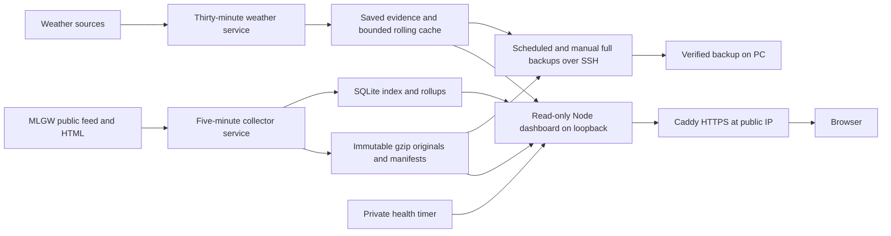

# MLGW outage history and dashboard: design plan

Prepared September 16, 2026; operating state reconciled after the September 22–23 audit release. See [current status and the documentation index](reports/PROJECT_STATUS.md). Editing this plan does not itself authorize additional implementation work.

**September 22 deployment:** the user selected a DigitalOcean Linux VM and public-IP access, and authorized deployment. The $12/month, 1 CPU / 2 GB / 50 GB Ubuntu VM now hosts the existing filesystem/SQLite application at https://64.225.60.118. Linux services run five-minute outage collection and 30-minute weather refresh continuously. All retained history was verified during migration, and local collectors are stopped. HTTPS and certificate renewal are configured. The [deployment guide](reports/DIGITALOCEAN_DEPLOYMENT.md) supersedes earlier local-only and free-first implementation assumptions below; long-term retention and evidence protections remain in force.

**September 22–23 audit release:** [recovery and operational hardening](reports/TECHNICAL_AUDIT_IMPLEMENTATION.md) is deployed, including schema-2 deterministic projection, explicit rebuild/rollback, per-client request limits and CI/browser checks. Verified full PC backups are installed for 10 AM Central daily and at user login; downloads require this PC online with the user signed in. External monitoring is prepared but unconfigured by choice. Long-term automatic offload and deletion remain future work.

**Historical scope, September 18:** collection, validation and the dashboard run locally. The 24-hour pilot passed; the seven-day collector trial continues. The dashboard, heatmap, Census per-capita maps, weather replay, legacy integration and two rainfall/wind cases with matched references are complete. The requested [autonomous continuation](reports/DEVELOPMENT_COMPLETION_STATUS.md) adds verified cold/heat comparisons, original legacy-grid cold summaries, isolated ongoing weather refresh/retention, a real-data desktop-transfer rehearsal and a guarded seven-day acceptance command. Three additional rainfall/wind candidates failed the existing reference screen; snow/ice and some heat periods lack sufficient outage coverage. Saved study evidence remains protected under a shared 1 GiB weather cap. The existing Quick Tunnel keeps its September 18 3:06 PM CDT expiry. Cloud provider validation/deployment and Phase 4B installation/cleanup still need account/runtime setup; unsupported source families, missing legacy evidence and richer local-exposure rankings remain open.

**Access update, September 18:** after the September 17 session was closed at the user's request, the user requested a new Quick Tunnel deployment of the latest version. The new password-protected session began at 7:06:19 AM CDT and expires at 3:06:19 PM CDT. Current-feed, weather and legacy routes passed external verification and browser sign-in/replay. Storage and collection remain local.

**Source review update, September 17 at approximately 12:20 PM CDT:** the 24-hour pilot completed with 290/290 observed slots and passed its local observation gate. All captures mirrored into the existing seven-day collector, which continued directly at the next slot. All 297 captures at the 17:15 UTC cutoff replayed and restored successfully; dashboard API totals/freshness matched. The [completed review](reports/PHASE1_STATUS.md) documents source start/location edits and an HTML-inclusive storage model. Full seven-day acceptance and provider validation remain pending; earlier statements that both pilots were running describe the morning checkpoint.

## 1. Recommended approach

The selected production implementation uses Node 24, immutable compressed filesystem archives, SQLite and a static dashboard on a DigitalOcean Linux VM. Caddy terminates HTTPS and proxies the loopback dashboard; systemd manages the collectors. The original Cloudflare proposal and its unrun benchmark remain historical alternatives. Keep the parser and analytics portable.

Production uses **five-minute collection**; a future one-minute option requires source-frequency measurements and implementation changes, because the current production configuration rejects other cadences. Keep detailed observations indefinitely where practical. Retain them in the cloud while space permits. The planned long-term offload protocol would transfer detail older than one year to this Windows PC under storage pressure, verify it and then remove only those verified cloud copies. Keep the newest year in cloud storage and long-term summaries available to the dashboard. Current full backups preserve all canonical cloud history and do not enable this deletion protocol.

The dashboard is **accessible to anyone with its link**, with light expected use. The user selected the **$12/month DigitalOcean VM** after considering cloud options. Additional paid backup or storage products are not enabled automatically.

The useful first version answers:

- How many customers and reported outages are affected now?
- How has that changed over the last day, week, or month?
- Where are the current outages, and what did the map show earlier?
- Which increases, long-running outages, or recurring locations warrant a closer look?

The weather extension will also answer:

- Where was precipitation occurring as outages appeared, and how much rain fell during and before that period?
- Which areas had more newly reported outages or greater observed interruption burden during heavy rain, prolonged rainfall, high winds, flash-flood episodes, snow, ice and heat waves?
- Do those associations persist across comparable events, weather exposure and population denominators, with missing observations and source-format changes visible?

### Confirmed requirements and remaining setup choices

The audience, retention intent and 30-day offline-PC storage allowance retain the user's September 16 requirements. The September 22 choice of a $12/month DigitalOcean VM supersedes the original free-first hosting preference. Cloud deployment and recurring full PC backups are installed; long-term offload remains separate work. The 30-day allowance is a capacity-planning requirement, not a backup-freshness guarantee: private health degrades when the verified PC backup is over 36 hours old.

| Decision | Requirement or selected approach | Implementation implication |
| --- | --- | --- |
| Audience | Anyone with the link; mostly personal use | No viewer login. Cache public reads, bound traffic, and keep administrative/archive operations authenticated. An unlisted URL does not enforce privacy. |
| History | Preserve detail as long as possible; newest year always in the cloud | Move older detail to the PC only when storage pressure warrants it; verify local receipt before cloud deletion. |
| Cloud provider | DigitalOcean Linux VM, selected September 22 | Existing filesystem/SQLite implementation is deployed; use the public IPv4 address first. |
| Budget | Selected $12/month VM | No additional paid backup/storage products enabled; monitor growth and retain storage stop guards. |
| Scope | All reported MLGW electric outages; anomalies, historical heatmap, Census per-capita maps and prepared weather/rainfall views | Verified legacy history has separate dashboard views. Four rainfall/wind/cold/heat cases, matched references, native-grid cold summaries and bounded rolling weather refresh/retention are implemented. Additional supported source families, independent episodes and richer exposure analysis remain open. Automated notifications remain optional. |
| Validation and access now | Public HTTPS at https://64.225.60.118 | Linux tests, real archive restore, external route checks and certificate renewal rehearsal passed; earlier Quick Tunnel sessions are historical. |
| Weather scope | Radar, rainfall accumulation and historical conditions including flash flood, prolonged rain, snow, ice and heat | Include wind alongside rain; distinguish measurements, warnings, reported events and derived condition labels. Start with radar/rainfall, then comparative analysis. |
| Desktop setup | PC is on irregularly; reserve at least 30 days of offline headroom | Size the reserve from projected storage growth, including storm periods. The provisional archive folder is `C:\Developer\mlgw-outage-scraper\archive`; recheck capacity for Phase 4B. |

## 2. Source discovery: what is already verified

Direct requests to the live map and its feed succeeded during this planning session. The map itself points to the GeoJSON URL; no login, browser automation, or map-tile extraction was needed.

| Source | Verified observation |
| --- | --- |
| [MLGW outage-map page](https://outagemap.mlgw.org/OutageSummary.php) | Loads `geojson.php` into an ArcGIS GeoJSON layer. Its JavaScript sets a 900-second page-refresh timer. It renders individual features and clusters them in the browser. |
| [MLGW GeoJSON feed](https://outagemap.mlgw.org/geojson.php) | Returns a JSON `FeatureCollection` with point coordinates and outage properties. The inspected response contained 15 features totaling 290 affected customers. This is one observation, not a sizing forecast. |
| [MLGW map description](https://www.mlgw.com/outagemap/) | Describes general outage information across Shelby County, based on reported and known outages; exact address details are deliberately unavailable. |

Observed field mapping:

| Source field | Proposed interpretation |
| --- | --- |
| `OUTAGE_NO` | Source outage identifier; store as a string |
| `CUR_CUST_AFF` | Currently affected customer count |
| `TIME_STAMP` | Reported start time, as labeled by the map popup |
| `EST_REPAIR_TIME` | Estimated restoration time; sometimes empty |
| `DURATION` | Source duration text; preserve, but calculate analytic durations from timestamps |
| `STATUS`, `IMPACT` | Source status and qualitative affected-area description |
| `geometry.coordinates` | Longitude, latitude; preserve the original GeoJSON |
| Feature `id` | Small sequential numbers in the sample; do not use for cross-snapshot identity |
| `OUT_CAUSE` | Present, often blank, and omitted from the map's visible popup; exclude from the initial dashboard |

The sample had no top-level feed update timestamp and no `ETag` or `Last-Modified` response header. The HTML page's “current as of” text must not automatically be treated as the GeoJSON's publication time. The outage host's `robots.txt` returned 404; that does not establish a reuse license.

Before production, check applicable source terms and any published collection guidance, and document the endpoint contract. Use a contactable application User-Agent, low request volume, and backoff. If access becomes restricted, stop and reassess the supported source. No customer-account access is needed.

**Unverified for the current feed:** publication cadence, outage-ID stability/reuse, coordinate precision, and completeness during storms. New-feed history starts with collection. The earlier scraper provides a separate historical source, described below; missing observations cannot be reconstructed.

### Historical evidence from the earlier scraper

Inspected [jpbranson/mlgw.outage.3 at revision `ea0c830`](https://github.com/jpbranson/mlgw.outage.3/tree/ea0c8309337171b398ffadd5d6105d997f9b354b). Analysis used its consolidated R data and the complete current file tree, plus one saved page/event pair. It did not scan every historical Git commit or establish all-time MLGW storm maxima.

| Measurement | Result | Design implication |
| --- | --- | --- |
| Consolidated event records | 1,997,747 rows; 53,274 distinct observation timestamps across 806 dates, February 8, 2022–February 20, 2025 | Existing history can seed storm comparisons; these are repeated event observations, not two million unique outages. |
| Largest recorded affected-customer total | **117,861**, June 26, 2023; 601 reported outages in that observation | Charts and anomaly rules must handle large changes in customer count independently of feature count. |
| Largest recorded outage total | **3,998**, February 8, 2022; 45,382 affected customers | Use about 4,000 current-format features as an observed-scale stress case, plus 10,000 for headroom. |
| Event rows at the largest outage total | 4,094 rows, but 3,998 distinct extracted event identifiers | Legacy imports must deduplicate within a capture and must not use raw row count as the outage total. |
| Recent saved snapshot files | 20,934 files forming 10,467 timestamp pairs, September 11, 2024–February 20, 2025; **38.86 MB combined** | Compressed historical storage is encouraging, but covers a different format and a limited date range. |
| Bytes per recent compressed pair | Mean 3.71 KB; median 3.49 KB; 95th percentile 5.13 KB; maximum 17.95 KB | Compression should be measured early in the new design. These are not new GeoJSON payload estimates. |
| Largest saved page in that recent tree | September 12, 2024: 114,121 bytes of extracted page text, stored as a 12,948-byte RDS; associated page summary: 20,793 customers / 293 outages | A concrete storm fixture for legacy parsing, separate from the larger storms in consolidated history. |
| Filename-based capture spacing in that recent tree | Median 17.2 minutes; 95th percentile 41.1 minutes; about 64% of intervals exceeded 15 minutes | The recorded archive does not deliver consistent 15-minute sampling. This is an observation of stored files, not proof that scheduler delay alone caused every gap. |

Method: extract one unique `(time, outage_num, cust_affected)` summary per timestamp from [`total_outages.rds`](https://github.com/jpbranson/mlgw.outage.3/blob/ea0c8309337171b398ffadd5d6105d997f9b354b/total_outages.rds); never sum its repeated customer totals. For file sizes, pair `.RData` and `_txt.rds` by filename timestamp in the [saved data directory](https://github.com/jpbranson/mlgw.outage.3/tree/ea0c8309337171b398ffadd5d6105d997f9b354b/data). File gaps use local filename times and are approximate around DST. Dates above follow the stored timestamp date; timezone reconciliation is part of import.

The [`total_parsed_polygons.rds`](https://github.com/jpbranson/mlgw.outage.3/blob/ea0c8309337171b398ffadd5d6105d997f9b354b/total_parsed_polygons.rds) file contains 18,906 snapshots with finite spatial coordinates, 127 distinct grid-cell IDs, and coverage dated March 8, 2022–April 27, 2024. Its 154,933 valid snapshot/cell records expand to 774,665 vertex rows. Other rows include missing-coordinate placeholders; those are not extra outages. The latest [scraper source](https://github.com/jpbranson/mlgw.outage.3/blob/ea0c8309337171b398ffadd5d6105d997f9b354b/R/job.R) has polygon processing commented out, so spatial coverage must be audited separately from total-count coverage.

Import this history with `source_format=legacy_html` and preserve its geographic grid polygons. Use `source_format=current_geojson` for new point features. Legacy cell IDs are geographic-area IDs, not current outage IDs; do not turn grid centroids into precise outage locations or distribute grid customer totals among individual events. Show a source-format boundary on charts and do not use old-map observations to train the new-feed anomaly baseline without a comparability check.

The owner's three-repository [September 17 overlap audit](reports/LEGACY_HISTORY_AUDIT.md) confirms that all consolidated total observations and valid spatial records from `mlgw.outage` and `mlgw.outage.2` are contained in `mlgw.outage.3` at the pinned branch tips. Separate compressed staging retains all provenance for the 53,274 total observations and 18,906 grid captures, with no matching-identity conflicts. Subsequent [timezone recovery](reports/LEGACY_TIMEZONE_RECOVERY.md) resolves 53,273 totals and all grid snapshots, leaving one total explicitly unresolved. The [coverage audit](reports/LEGACY_COVERAGE_AUDIT.md) inventories 53,679 captures across selected revisions, classifies empty/failed captures and retains one extra nonempty original for reconciliation. These completed audits preserve original staging. The [separate dashboard publication](reports/LEGACY_DASHBOARD_STATUS.md) is complete for verified totals and grid snapshots; an exhaustive raw-page/Git-history import is outside that completed scope.

### Historical weather sources: documented candidates

Source documentation was reviewed September 16, 2026. The September 16–17 [weather checkpoints](reports/PHASE3A_STATUS.md) subsequently verified bounded radar, numeric rainfall, station and warning samples, followed by dashboard controls, airport observations, 24/48/72-hour rainfall validation/display, source-specific station quality interpretation and finalized event/county-zone warning checks. The supported sample checkpoints and separate legacy import are complete. September 18 adds four verified case/reference comparisons and bounded rolling refresh/retention; additional station source families remain excluded until validated. Further historical comparisons must meet the same explicit coverage and alignment checks.

| Source | Planned use | Resolution, history and limits |
| --- | --- | --- |
| [Iowa Environmental Mesonet NEXRAD mosaics](https://mesonet.agron.iastate.edu/docs/nexrad_mosaic/) and [timestamped map services](https://mesonet.agron.iastate.edu/ogc/) | Historical radar reflectivity overlay synchronized with outage replay | Five-minute mosaics; the higher-detail N0Q archive is documented from November 2010. Reflectivity is a signal in dBZ, not rainfall depth or confirmed surface precipitation. Check actual frame availability; transparent pixels alone cannot prove dry conditions. |
| [NOAA MRMS precipitation products](https://mapservices.weather.noaa.gov/raster/rest/services/obs/mrms_qpe/ImageServer), [IEM archived layers](https://mesonet.agron.iastate.edu/ogc/) and [NOAA open-data archive](https://registry.opendata.aws/noaa-mrms-pds/) | Rainfall-rate/accumulation display and quantitative spatial rainfall summaries | Approximately 1 km products. IEM documents archived 1/24/48/72-hour accumulation layers at hourly endpoints since early 2015. NOAA's open archive starts in October 2020. Use numeric grids for analysis, not colors sampled from display tiles. Product variants, gauge adjustment, version changes, coverage and units must remain explicit. |
| [NOAA GHCNh](https://www.ncei.noaa.gov/products/global-historical-climatology-network-hourly), replacing Global Hourly / ISD | Historical temperature, dew point/humidity, wind/gusts, precipitation and available present-weather/snow observations | Validated station/year PSV samples preserve quality fields; the tested JSON subset path omitted essential metadata. The refreshed Memphis snapshot ends September 9, 2026 at 16:54 UTC; the prior August 26 snapshot is retained and the September 16 sample remains unavailable. Station readings remain regional, with source-specific quality, reporting interval and location. |
| [NOAA Storm Events](https://www.ncei.noaa.gov/access/storm-events-database/assets/pdf/Storm_Events_Database_User_Guide.pdf), with [IEM NWS warning archives](https://mesonet.agron.iastate.edu/ogc/) where supported | Context for flash floods, thunderstorm winds, snow/ice, heat and other documented episodes | Event records can be county/forecast-zone based and are published with a delay. Warning polygons describe warned areas, not confirmed damage footprints. Missing reports do not establish that a hazard was absent. Audit archive completeness and geometry before spatial use. |

The later [event-context checkpoint](reports/EVENT_CONTEXT_STATUS.md) validates six selected cases using pinned 2022/2023/2024/2026 NOAA detail files and IEM county/zone warning snapshots. Thirteen selected event records and eight administrative alerts independently verify. The current NOAA release only has events beginning through May 2026, so September stays outside observed coverage. Warning boundary vintage is not independently certified, and archived later updates prevent treating these records as exact issuance-time replays.

IEM's [MRMS archive notice](https://mesonet.agron.iastate.edu/archive/mrms.php) now describes a rolling 30-day cache for hourly raw ZIP files. Do not treat that convenience cache as permanent storage; use the documented long-term archives and preserve the inputs needed for each saved analysis. NOAA's MRMS open-data archive does not require an AWS account. Access methods and caching conditions must be checked during implementation; public data availability is not an uptime guarantee.

The current-feed outage archive starts September 16, 2026, but the already identified legacy observations can support older weather comparisons in the separate legacy archive. Spatial comparisons are limited by the separate legacy geometry coverage and gaps described above. Total-only observations support regional time-series comparisons, not invented neighborhood maps.

**Legacy timezone recovery update:** the separate [verified recovery catalog](reports/LEGACY_TIMEZONE_RECOVERY.md) resolves 53,273 historical total observations and all 18,906 grid snapshots. One total's timezone remains unresolved. Full original-epoch checks, source-version/commit rules and independent R verification replace the earlier blanket unresolved-time status for supported records. The subsequent [capture-coverage checkpoint](reports/LEGACY_COVERAGE_AUDIT.md) inventories 53,679 captures, classifies empty/failed records and preserves one extra nonempty original for reconciliation. The [legacy dashboard](reports/LEGACY_DASHBOARD_STATUS.md) now exposes those gaps and exclusions in a separate archive view. Original staging is preserved.

## 3. Collection frequency and reliability

Five minutes remains the provisional cadence: finer than the requested 15-minute resolution and 288 feed requests per day, plus the separately retrieved HTML checks. The [completed 24-hour pilot](reports/PHASE1_STATUS.md) measured byte/meaningful changes and response spacing; it supports this cadence without proving the source publication interval or storm completeness. The local trial and continuing cloud observations supply longer operating evidence; the stopped local trial has not been accepted as a completed seven-day run.

| Poll interval | Polls/day | Polls/30-day month | Polls/365-day year |
| --- | ---: | ---: | ---: |
| 15 minutes | 96 | 2,880 | 35,040 |
| 5 minutes | 288 | 8,640 | 105,120 |
| 1 minute | 1,440 | 43,200 | 525,600 |

The deployed `mlgw-collector` systemd service runs `scripts/production-collector.mjs`, checks every 30 seconds and captures the next due UTC five-minute slot. Persistent next-due/backoff state and the SQLite lease prevent duplicate publication. The browser does not drive collection. The production configuration currently requires five-minute polling; a one-minute mode would need implementation and validation.

If source changes occur more frequently than five minutes, consider fixed one-minute polling after checking resource use and source guidance. An optional later mode can poll every minute during elevated activity and every five minutes otherwise; a future durable next-due policy could select the interval without changing the service schedule.

Polling resolution and information freshness are different. A five-minute collector can repeatedly receive the same source state; faster polling cannot expose changes that MLGW has not published. Outages that begin and end between observations may never be captured.

### Deployed cloud collection attempt

These steps describe the deployed filesystem/SQLite collector. The [deployment guide](reports/DIGITALOCEAN_DEPLOYMENT.md) records Linux execution, real archive recovery and the service lifecycle; [Phase 2](reports/PHASE2_STATUS.md) preserves the original local implementation evidence.

1. Assign an attempt ID and a UTC scheduled-slot ID. Record actual request and response times separately.
2. Fetch the allowlisted GeoJSON URL with a 15-second timeout and a configurable response-size ceiling. Use conditional headers if the source later supplies validators.
3. Preserve the received body and selected response metadata before parsing/normalization. Production retains a byte-exact gzip original and its uncompressed-body hash; redundant staging is removed only after verified archival/indexing. Compression, replay and restore were exercised in Linux and on the VM.
4. Validate the collection, required identifiers, nonnegative integer customer counts, timestamp parsing, and geometry. Preserve unknown fields in the private raw archive. Flag out-of-area coordinates for review rather than silently losing those outages.
5. Produce a normalized snapshot, totals, and comparisons with the previous valid observation. Store timestamps, validation results, and parser version.
6. Write immutable archive objects and manifests first. Commit the SQLite snapshot reference and summaries together only after those objects exist. Advance the latest pointer only if this capture is newer than the current one.
7. Update the cached dashboard result. Record failures without converting them into zero outages.

Use a short expiring lease to prevent overlapping collectors. Make slot publication idempotent, keep retry attempts as separate records, and tolerate archived objects awaiting indexing after a failed database commit. Retrying publication must not double-count a snapshot. A recovery pass can find archived but unprocessed captures and process them later with their original observation times.

Retry transient network/5xx failures at most twice with jitter inside a bounded run. Honor `Retry-After` for 429 responses, even if that means skipping scheduled slots. A delayed run captures the current state at its actual retrieval time; it must never pretend to backfill the earlier scheduled instant.

Track two independent health measures: **last successful retrieval** and **evidence of source freshness**. Identical content alone is not evidence of failure. With no reliable source timestamp, show “retrieved at” and “source update time unavailable.” Flag collection gaps above 10 minutes and display a clear stale-data banner at 15 minutes. Use an independent heartbeat check so a stopped scheduler can be detected.

## 4. Deployed cloud architecture

One DigitalOcean Ubuntu VM runs the existing Node/filesystem/SQLite application. Separate systemd services isolate the outage collector, rolling weather refresh and read-only dashboard. Caddy terminates HTTPS at the selected public IP and proxies the dashboard on loopback. A health timer checks observation/weather freshness, runner heartbeats, storage pressure, free disk space and a verified PC backup no older than 36 hours; a separate timer renews the IP certificate.



The public dashboard has no viewer login and exposes only allowlisted reads. Canonical raw archives, administrative operations and backup downloads are not public routes; administration uses SSH. Runtime services use the unprivileged `mlgw` account and dedicated writable directories. The dashboard's canonical archive mount is read-only, with write access retained only where SQLite WAL coordination requires it. Data routes have per-client and aggregate limits; `/api/health` remains available under quota pressure, and `/api/ready` returns 503 when current observations are unhealthy. Credentials and local trial state were excluded from deployment bundles.

The production collector has no trial deadline, restarts after failures and resumes its recorded schedule. Source restrictions, operator stop markers and urgent storage stops require review and survive service restarts. The two local PC collectors are stopped, so only the VM polls upstream sources. The installed Windows task downloads and verifies full backups daily and at login. External notifications remain unconfigured by choice, and automatic deletion of canonical history remains disabled.

### Alternatives considered

The original September 16 proposal used Cloudflare Workers/Durable Objects, R2 and D1. It was not deployed, and its provider-specific compute/storage gates are not claims about this VM. The [prepared Cloudflare probe](README.md#cloud-runtime-probe-deferred-prepared-not-deployed) and dated cost model below remain reference material. AWS serverless compute was also considered; GitHub Actions was rejected as the primary sampling clock. The selected VM preserves the already-validated filesystem/SQLite implementation.

## 5. Storage and data model

Canonical source bodies are immutable gzip files; each observation has a manifest and pinned parser. SQLite stores the compact index and rollups rather than one indefinitely retained row per outage feature per poll. The live data root is `/var/lib/mlgw/data`; local development uses the matching `data/` layout.

### Current filesystem layout

```text
data/collector/archive/objects/<original-body-sha256>.gz
data/collector/archive/manifests/<attempt-id>.json
data/collector/archive/parsers/<parser-version>-<parser-sha256>.mjs
data/collector/index.sqlite
data/collector/production-state.json
data/collector/staging/
data/weather/cache/
data/weather/live-cache/
data/weather/production/state.json
```

Byte-identical responses can share archived bodies, while each attempt retains its own times and provenance. Failed observations are not converted to zero outages. Production removes redundant staging only after verifying its durable copy. It preserves canonical originals; no unconditional one-year expiration or automatic history offload is enabled.

### SQLite tables

| Table | Stored purpose |
| --- | --- |
| `poll_attempts` | Attempt ID, scheduled/received times, HTTP status, outcome/error, archive keys and hashes |
| `attempt_facts` | Compact projection inputs for deterministic slot selection and zero confirmation, including counts, HTML totals, flags and recent event keys |
| `snapshots` | Unique accepted slot, capture time, raw key/hash, parser identity, quality and recent event-key cache |
| `totals` | Snapshot ID, affected customers and reported outages |
| `rollups` | Resolution/bucket, customer-minutes, covered minutes, mean/peak customers, peak outages and observation count |
| `leases` | Collector owner and expiration |
| `collector_state` / `maintenance_queue` | Internal state and queued rollup days |

The exact schema is `src/durable/schema.sql`, version 2. Projection policy `outage-projection-v2` selects the earliest valid candidate per slot with a stable ID tie break and re-evaluates dependent zero classifications after late imports. Time indexes and unique slot constraints bound reads and prevent duplicate publication. Coverage accompanies rollups. Older or unknown schemas require an explicit separate rebuild using `scripts/rebuild-index.mjs`; the canonical archive and pinned parsers reproduce the index. Copying only an open SQLite main file is not a valid live backup.

Production has a 20 GB collector budget, a 5 GB free-disk reserve and warning/offload/urgent fractions of 70%/80%/90%. These are pressure thresholds, not installed automatic offload jobs. Preserve the newest year and older evidence while capacity permits; review growth before those thresholds are reached.

### Automatic archiving to this PC

**Current backup implementation:** `npm run deploy:backup` downloads full verified bundles over SSH using an ACL-protected local key. The installed Windows task runs daily at 10 AM Central and at login, with three 30-minute retries and no overlapping runs. The PC must be online with the user signed in. Packages and receipts accumulate in `data/deployment/backups/`, with task output in `reports/scheduled-backup.log`. A verified cloud receipt is recorded after the local checksum succeeds; only temporary remote packaging is removed. Full-backup restore was verified. No automatic deletion of PC backups or canonical cloud history is enabled.

**Long-term offload preparation:** the [local transfer core](reports/DEVELOPMENT_COMPLETION_STATUS.md#desktop-transfer-core-and-rehearsal) supplies bounded bundles, resumable downloads, a SQLite verification catalog, authenticated receipts, restore and a non-executable cleanup-eligibility calculation. An actual 89-capture partition passed download/restore/replay. The offload receipt transactions, cleanup journal and installation described below remain unimplemented; the scheduled full-backup task does not implement that protocol.

The planned partition-offload protocol uses a **desktop-initiated download** over outbound HTTPS, so the PC needs no public address, open inbound port or always-running web server. It should run daily, resume after missed runs and prevent overlapping executions. Installing that resumable offload worker and selecting its final archive folder remain future tasks; the installed full-backup task currently uses SSH.

The archive preserves original payloads, normalized geometry/properties, UTC observation metadata, schema/parser versions, quality flags, and per-file SHA-256 checksums. Use portable daily or monthly bundles with a manifest, bounded part sizes, and a small local SQLite catalog. A source-to-bundle index preserves every retained observation even when repeated bodies are deduplicated. Retain long-term chart summaries and the archive catalog in the cloud.

Transfer protocol:

1. Predict storage use from measured recent growth and storm scenarios. Trigger preparation at 70% of the configured cloud archive budget, begin offloading older-than-one-year detail at 80%, and flag urgent pressure at 90%. Start earlier if needed to retain at least 30 days of projected incoming data plus transfer staging and cleanup-grace capacity. Include other VM data and temporary backup/transfer packaging in disk forecasts; these percentages are planning thresholds, not provider-enforced caps.
2. Select oldest eligible UTC date partitions only when every observation in them is strictly older than the current instant minus one calendar year. The plan does not permit moving the protected year out of cloud storage.
3. The PC checks available disk space, downloads immutable parts into `.partial` files, resumes interrupted transfers, checks byte counts and SHA-256, and verifies that the bundle can be read. Write the completed manifest/catalog atomically only after every part is verified.
4. The PC sends an authenticated receipt identifying the manifest version, object list, hashes, and completed local verification. A narrowly scoped machine credential lives in Windows-protected credential storage, never in the public dashboard.
5. The cloud records the receipt. After a seven-day grace period and a second successful local verification, the cleanup job rechecks age eligibility and removes only the receipted cloud detail. Keep manifests and summaries. Deduplicated payloads referenced by the protected year cannot be deleted.
6. After handoff, the public dashboard identifies that date's detailed map as archived to the owner’s PC. It continues to show cloud summaries. The owner can inspect full detail locally or explicitly restore selected bundles to the cloud for sharing; the public page does not connect to this desktop.

Use idempotent receipts, immutable manifest IDs, and a per-part cleanup journal so retries or partial deletion cannot lose unacknowledged files. Export SQLite observation metadata before any future cloud rows are pruned. Verify original bytes with SHA-256 independently of transfer protocol metadata. Test a restore from the actual downloaded bundle before first enabling cleanup.

The PC is on irregularly, so **30 days of offline headroom is a confirmed requirement**. If it is off, disconnected, full, or has failed verification, leave the cloud copies intact, retry when it becomes available, and show archive-backlog/last-receipt status. Size the reserve from measured storage growth and storm scenarios, with additional room for transfer staging and the deletion grace period. Forecast pressure early enough to preserve that reserve. A verified single-PC archive remains vulnerable to disk loss; a second local/external-drive copy is advisable where available.

There is a real capacity boundary: offloading data older than a year cannot help if the newest year alone exceeds provisioned storage, or if the PC stays unavailable beyond the reserve. Measure this before launch. Compress/deduplicate first, prefer five-minute over one-minute collection if needed, and review the provisioned capacity before adding storage or changing the VM plan. If the requirements no longer fit, surface the storage/cadence decision rather than silently deleting the protected year, losing old detail, or promising unlimited retention.

### Weather storage and jobs — Phase 3A, extended in Phase 5

Keep weather acquisition and processing separate from MLGW polling. Weather failures, rate limits or heavy raster processing must not delay outage capture or alter an accepted snapshot. Use a separate weather service, memory limit and cache budget. Cloud refresh and memory use were checked during deployment; heavy backfills remain bounded explicit work.

The deployed weather service refreshes recent radar, hourly rainfall and KMEM METAR every 30 minutes continuously, using separate production state. The former PC runner is stopped. Its disposable cache is capped at 256 MiB within the shared 1 GiB weather budget; radar expires after four hours, rainfall/METAR after 24 hours. Saved study evidence never expires through this runner. Shared writer/budget locks preserve aggregate limits; source latency and matching tolerances can still leave weather unavailable. Annual GHCNh revisions and new study acquisition remain explicit bounded jobs. See [operation and stop/resume controls](README.md#automatic-weather-refresh). The VM schedule has no trial deadline. Scheduled full backups include saved study evidence and exclude disposable rolling weather; external alerts remain unconfigured.

- Maintain a weather manifest with provider, product/version, source URL, observation/valid time or interval, retrieval time, units, CRS/grid or station ID, quality/missing-data flags, checksum and processing version. Record original weather times even when displaying a nearest eligible frame.
- Cache selected Memphis-area imagery and numeric subsets on demand. Use immutable timestamped cache keys, bounded time windows, request concurrency and retry/backoff. Avoid continuously retaining national radar volumes. Distinguish disposable display-cache entries from evidence required to reproduce a saved comparison.
- Preserve source-aligned numeric rainfall subsets, station observations, event/warning records and checksums for saved analyses. Keep full national files only as bounded processing inputs where required; validate the retained subset and its extraction provenance before discarding temporary derivatives. Do not change outage retention rules.
- Store compact weather summaries by native weather cell/station and time bucket, plus area-weighted summaries where appropriate. Store saved analysis periods, exposure/coverage, metric definitions and source/vintage versions. Separate measured data from derived condition classifications and cached visualizations.
- Derive long accumulations from non-overlapping increments or an explicitly matching source accumulation period. Never add overlapping rolling 24-hour rainfall totals. Preserve missing and trace values as distinct from measured zero.
- Measure download volume, disk growth, decode time and map payloads using a wet multi-day period as well as dry data. Select a weather-cache size after those measurements; it must fit inside the local free-space floor and any future shared cloud reserve.

## 6. Time, outage identity, and spatial meaning

Store observation times as UTC instants; display them in `America/Chicago`. The current GeoJSON feed's outage start/repair strings lack explicit offsets; preserve them and record the provisional Central-time interpretation. Legacy capture timestamps follow the separately verified source-version/original-epoch rules, and must not inherit that blanket assumption. Use explicit format/time-zone parsing, retaining unresolved fall-back ambiguity rather than inventing an instant.

Use `(OUTAGE_NO, reported start time)` as a provisional event key. Test its stability across the pilot. If a start time is corrected or an ID disappears and reappears, retain the source observations and mark identity uncertain; do not silently invent a new confirmed event or merge unrelated incidents.

An outage disappearing from a complete snapshot means **no longer reported**, not a confirmed restoration. Optionally confirm disappearance on the next valid snapshot, but retain the first-absence observation time. Invalid/incomplete captures cannot close outages. The interval between last seen and first absent bounds the observed disappearance; actual restoration time remains unknown. Duration statistics should distinguish source-reported start time, first observation, last seen, first absent, and still-active events.

Validate GeoJSON coordinate order as `[longitude, latitude]` and normalize for the mapping library at the boundary. Preserve original point geometry and precision. These points are approximate reported locations; they are not customer addresses or outage-boundary polygons. If the feed later changes geometry type, archive it and flag the schema change before publishing unsupported geometry.

For spatial trends, aggregate reported point locations into a versioned grid of roughly 1 km cells, with consistent projected boundaries. Store the grid definition once. Label results as “reported outage activity near this location.” Do not infer service areas from marker circles or claim all affected customers reside inside a point's grid cell. Neighborhood/ZIP summaries can follow if trustworthy boundaries are selected; counts without customer-population denominators are not neighborhood reliability rates.

The implemented per-capita view uses 2020–2024 ACS B01003 population estimates, margins of error and matching 2024 Census block groups; see [reference provenance](reference/README.md). It reports provisional events or peak simultaneous customers per 1,000 estimated residents. Utility accounts are not people, and approximate outage points may represent accounts across boundaries. These are location-based normalized counts, not official reliability rates or resident outage percentages. For older analyses, retain the population/boundary vintage and explicitly label any fixed modern denominator applied to earlier years.

Weather alignment must preserve its native precision. Join each radar frame to an eligible outage observation with both timestamps and the offset visible. Default replay to the latest available frame at or before the selected time, with a small product-specific tolerance established during source validation; never silently fall back to live imagery or an arbitrarily old frame. Distinguish a rainfall accumulation's start/end from a radar instant. Backward-looking weather windows must end at the analysis time, not include future rainfall.

Aggregate rainfall over an area's intersection with valid weather pixels and report coverage; a small block group does not gain finer-than-radar measurements. Keep station readings regional unless an explicit, validated interpolation is added. Preserve legacy grid polygons for weather joins; do not assign their customer totals to modern block groups by centroid or assume uniform distribution. Compare source formats separately unless a documented coarser common geography and compatible metric exist.

## 7. Trends and anomaly detection

Start with transparent rules and aggregate statistics. Machine learning is unnecessary for the first version.

| Metric | Method and interpretation |
| --- | --- |
| Affected customers | Sum valid `CUR_CUST_AFF` values within one snapshot; never sum snapshots and call that unique customers |
| Active reported outages | Count source features, separate from affected customers and browser clusters |
| Change over time | Difference between comparable valid observations; suppress event comparisons across gaps or suspect snapshots |
| Customer-minutes | Integrate affected-customer counts over observed time; an estimate of interruption burden, not an official utility metric |
| Geographic recurrence | Count distinct provisional events by reported-location cell; separate frequency from duration and affected-customer burden |
| Restoration progress | Falling affected-customer totals during a selected period, without assuming every decrease is a verified restoration |

For customer-minutes, use a left-step estimate `sum(customers_i * elapsed_minutes_i)` between consecutive valid observations no more than 1.5 configured poll intervals apart. Split contributions at rollup boundaries. Longer gaps contribute unknown time, not zeros. Report covered minutes and coverage percentage alongside daily/hourly estimates; avoid extrapolating a partial day to a whole day. End the estimate at the last observation.

Initial anomaly rules, with configurable thresholds:

- **Sharp increase:** at least 100 additional affected customers and at least double the prior comparable count. The implemented local dashboard uses the stricter 7.5-minute continuity limit (1.5 five-minute poll intervals) and rejects comparisons across intervening failed/suspect attempts. Treat a rise from zero using the absolute threshold. Mark this as a heuristic.
- **Unusually high activity:** after 28 sufficiently observed days, compare the current count with a robust baseline from the preceding 28 days. Use one valid observation per five-minute baseline slot so faster storm polling does not overweight storm periods. Flag counts above the median plus the larger of 100 customers or six scaled median absolute deviations. Require at least 90% baseline coverage and handle zero spread with the absolute floor. Persist baseline/rule versions.
- **Long-running reported outage:** highlight a source-reported duration above six hours, with ambiguous/missing start times clearly labeled.
- **Recurring location:** rank grid cells by distinct reported events and estimated burden over 7/30 days. Present rankings initially; avoid a statistically confident hotspot claim from sparse history.

Separate source/data-quality anomalies from electrical-outage anomalies. Unexpected schema changes, duplicate IDs, invalid geometry, and a sudden empty collection after a large outage are data-quality signals. Preserve suspect captures and show the last trustworthy state with a warning. Confirm a suspicious zero using subsequent captures and, when useful, the separately retrieved HTML summary; do not permanently reject legitimate recovery to zero. Store each source's retrieval time because the two requests are not atomic.

Do not publish SAIDI/SAIFI or unique households affected from this feed. Those require identities, denominators, and interruption histories that these public snapshots do not establish.

### Weather associations — Phase 5

Use descriptive, reproducible comparisons before fitting a predictive model. A spatial or temporal association is not a verified outage cause. Rain, wind, vegetation, network layout and other factors may coincide; do not assign causal labels to individual outages from a weather overlay.

- Define an episode and comparison window explicitly. Show outages already present at its start separately from newly reported events. Preserve first-observed versus source-reported start-time uncertainty and the existing provisional identity rules.
- Compare rain during the episode, preceding 1/24/48/72-hour accumulation, temperature and gust observations, and relevant documented hazards where supported. The implemented rainfall/wind cases use the previous completed weather hour plus 0, 1 or 3 additional lag hours on both the case and reference. Concurrent or other lag windows would require a separate versioned extension; avoid selecting only the lag that looks strongest afterward.
- Measure distinct provisional events, observed peak customers and customer-hours (`customer-minutes / 60`), including area-level burden only where spatial data supports it. Keep the existing gap rules and end integration at the last trustworthy observation. Report joint weather/outage coverage rather than treating unavailable weather or outage data as zero.
- Support heavy rain, prolonged rainfall, flash-flood episodes, strong wind, snow, ice/freezing rain, heat waves and cold as overlapping condition tags. Preserve whether a label comes from an observation, warning, finalized event record or a documented derived rule. Rainfall alone does not establish a flash flood; below-freezing temperature alone does not establish ice accumulation.
- Compare areas exposed to similar weather severity/duration and suitable season/time baselines. Show per-episode counts and burden, exposure hours, event counts and population denominators; avoid ranking vulnerability from an unadjusted all-time outage count or applying a single station's gust to every neighborhood as local truth.
- Display sparse conditions as descriptive case studies. Show the number of independent episodes and completeness; choose and document sample/coverage thresholds before publishing comparative rankings, and use uncertainty intervals once there are enough independent episodes. A single storm or partial season cannot establish a stable neighborhood ranking.

Weather-condition thresholds, station selection, lag tolerances and statistical sufficiency are implementation/validation decisions to document, not questions the user must answer before work can begin. Begin with rainfall and wind, then winter conditions and heat; a named user-priority storm can change that order.

## 8. A deliberately small dashboard

Use plain TypeScript with a small build setup, [Leaflet for GeoJSON maps](https://leafletjs.com/examples/geojson/), and [Chart.js for time-series charts](https://www.chartjs.org/docs/latest/). Keep the initial UI to one responsive page:

1. A freshness line and compact inline totals for affected customers, active reported outages, change, and daily peak.
2. A map and time slider. Start at the latest accepted capture; allow selecting an actual historical observation. Size markers by affected customers and show start/status/repair estimate in a popup.
3. One main line chart with customers/outage-count toggle, 24-hour / 7-day / 30-day presets, visible gaps, and anomaly markers.
4. A small list of long-running outages or recurring-location rankings, plus CSV/GeoJSON export for the selected bounded period.

Retain the user's visual direction: ggplot `theme_minimal` aesthetics, visuals before prose, Inter or an equivalent readable font, no emojis, plain drawn SVG previous/next arrows, and a minimum 16 CSS px (12 pt) for the main dashboard's interface text. Use a map-led utility layout with concise legends and expandable Data notes; avoid decorative cards, shadows, badges and unrelated animation. The implemented map choices are **One capture**, **Heatmap**, **Per capita**, **Locations** and **Rainfall**. Heatmap/per-capita modes use bounded outage periods; Rainfall offers prepared 24/48/72-hour intervals, an ending-time selector and a matching outage chart/CSV.

Selecting a chart point updates the map to that observation when its detail is available to the serving archive. Show the exact selected timestamp and avoid blending “latest” totals with an older map. Use five-minute observations for short ranges and hourly/daily summaries for long ranges, preserving bucket peaks so short spikes remain visible. Load an older map on demand; do not download an entire year of features to the browser. For a future cloud dashboard whose requested detail has moved to the PC, display its archive status and available summary instead of an empty map or a fabricated point layer. Legacy maps use the old grid representation and carry a visible source-format label.

The map library and basemap tiles are separate dependencies. For a small personal pilot, standard OpenStreetMap tiles may be used subject to its visible attribution, referrer, and caching requirements. Do not bulk-download or prefetch tiles. Keep the tile provider configurable and let the outage layer remain usable if tiles are unavailable. Reassess the basemap for public traffic. [OSM tile policy](https://operations.osmfoundation.org/policies/tiles/)

### Weather replay and comparison controls

Phase 3A has implemented a single-capture weather selector (off, radar reflectivity, preceding one-hour rainfall), opacity control, legend, attribution and exact matched time/interval. The capture slider and drawn arrows synchronize outage/weather replay; a regional KMEM temperature/wind plot uses only eligible prior station reports. Rainfall mode separately displays prepared 24/48/72-hour totals and a chart over that exact interval. Saved study acquisition is explicit and bounded; a separate maintenance runner refreshes recent display weather. Opening a view does not fetch upstream weather. The current-feed rainfall chart has no outage captures for June 2023 or September 2024; separate legacy and comparison pages now serve verified regional totals for those dates. The September 23 [dashboard extensions](reports/DASHBOARD_EXTENSIONS_STATUS.md) add automatic play/pause, a synchronized side-by-side rainfall/outage-density map for the same interval, and rolling 24-hour rainfall totals built from the retained hourly frames, so current-feed outages can be paired with recent rain.

The broadened prepared-period workflow and regional rainfall/wind case/reference comparisons are implemented for June 2023 and September 2024. December 2022 cold and June 2023 heat add temperature-based comparisons, with original-grid cold summaries. Arbitrary current-feed episode selection (up to 31 days, shareable by URL) is implemented for the chart and the period maps. The comparison catalog now has eight screened cases: `wind-march-2023`, `storm-aug30-2024`, `heat-june-2022` (with original-grid geometry) and `heat-august-2024` were added September 23 under the unchanged policy. Arbitrary weather-comparison episodes still require explicit, bounded weather preparation, and additional supported conditions remain planned. A single radar frame is compared with its matched outage capture, while period summaries must compare outages and rainfall over compatible stated intervals. An antecedent rainfall layer must be labeled as preceding the episode. Do not overlay one storm's rain on the all-time outage heatmap without changing or clearly separating the outage period. Show missing weather independently and keep outage replay usable when weather fails.

The Phase 5 interface provides four case choices, aligned weather/outage timelines, condition groups and matched snapshot comparisons at fixed 0/1/3-hour additional lags. The cold map preserves original polygons and missing cells; it is not a neighborhood temperature surface or population rate. The heat case explicitly retains preceding-storm recovery as a confounder. Area-by-condition frequency/customer-hours and per-capita weather comparisons remain future work where coverage and denominators support them. Keep attribution, population/weather vintages, uncertainties and methods available in Data notes and exports.

Implemented read-only API, served publicly through Caddy in production and through loopback in local development:

```text
GET /api/latest
GET /api/series?from=...&to=...&resolution=...
GET /api/snapshots?date=YYYY-MM-DD
GET /api/snapshot/<snapshot-id>
GET /api/series?view=spatial&from=...&to=...&geography=grid|block-group|location
GET /api/config
GET /api/config?view=census
GET /api/health
GET /api/export.csv?from=...&to=...&resolution=...
GET /api/export.csv?view=locations&from=...&to=...
GET /api/export.geojson?id=<snapshot-id>
GET /api/weather?at=<explicit-UTC-timestamp>
GET /api/weather/periods
GET /api/weather/period?id=<prepared-period-sha256>
GET /api/weather/image/<prepared-asset-sha256>
GET /api/legacy/catalog
GET /api/legacy/series?from=...&to=...
GET /api/legacy/snapshots?date=YYYY-MM-DD
GET /api/legacy/snapshot/<snapshot-id>
GET /api/legacy/export.csv?from=...&to=...
GET /api/legacy/export.geojson?id=<snapshot-id>
GET /api/legacy/catalog?view=comparisons
GET /api/legacy/series?view=comparison&id=june-2023&lag=0
GET /api/legacy/export.csv?view=comparison&id=june-2023&lag=0&table=reference
GET /api/legacy/series?view=comparison&id=cold-2022&lag=0
```

The weather routes read bounded saved and rolling catalogs and hash-verified prepared assets. They cannot launch collection or accept arbitrary upstream URLs. Phase 5 comparisons use the existing `/api/legacy/catalog`, `/api/legacy/series` and `/api/legacy/export.csv` routes with `view=comparison` (or `comparisons`), a prepared case ID (`june-2023`, `september-2024`, `cold-2022`, `heat-2023`) and a supported lag; `table=reference` selects paired CSV rows. The service merges the rainfall/wind catalog with `data/comparisons/conditions/catalog.json`; cold-grid summaries and geometry are included in the case JSON. Preview login is handled separately at `POST /preview/login`; the dashboard itself has no write routes. Retain authentication for any separately requested temporary preview. Public production access uses the request quotas, replay bounds and cache controls described in the [technical audit](reports/TECHNICAL_AUDIT_IMPLEMENTATION.md).

The local API limits series to 31 days, with five-minute detail limited to two days; hourly/daily resolutions serve longer ranges. Responses are capped at 12 MiB, with a shared 120 API requests/minute budget. Latest/health reads use no-store, series cache privately for 30 seconds, snapshots for 60 seconds and Census geometry/weather PNGs for one day. The preview gateway overrides all responses to no-store/private. Future public caching needs a separate design. Return source attribution, quality flags, and capture times consistently. Escape source strings in popups. Keep database bindings, storage credentials, and administrative operations out of the browser.

## 9. Cost and capacity estimates

The selected DigitalOcean VM is $12/month for 1 CPU, 2 GB RAM and 50 GB disk, verified through the account API during deployment. About 44 GiB of disk remained free at the operating check. The collector uses a 20 GB budget and 5 GB free-space floor; weather has a separate shared 1 GiB cap. Paid provider backups and extra storage products are not enabled. See the deployment guide for measured memory use and limits.

### Historical Cloudflare comparison — September 16

Prices below were checked against provider documentation on September 16, 2026. Allowances are shared with other applications in the account and may change.

| Service | Relevant allowance or price |
| --- | --- |
| Workers Free | 100,000 requests/day; 10 ms CPU per invocation, including scheduled invocations |
| Workers Paid, comparison only | $5/month minimum; a cron running more often than hourly has a 30-second CPU limit; not selected under the free-first preference |
| D1 Free | 5 million rows read/day; 100,000 rows written/day; 5 GB account storage, but only **500 MB per database** |
| R2 Standard | 10 GB-month storage, 1 million Class A operations/month, and 10 million Class B operations/month included; additional storage $0.015/GB-month; no egress charge |

Sources: [Workers pricing](https://developers.cloudflare.com/workers/platform/pricing/), [CPU limits](https://developers.cloudflare.com/workers/platform/limits/), [D1 pricing](https://developers.cloudflare.com/d1/platform/pricing/), [D1 size limits](https://developers.cloudflare.com/d1/platform/limits/), [R2 pricing](https://developers.cloudflare.com/r2/pricing/).

CPU is the key free-tier risk: parsing, hashing, normalization, compression, and serialization count; waiting for network I/O does not. Reducing polling frequency does not solve a per-invocation CPU overrun. Test ordinary current-format payloads, roughly 4,000 features based on the legacy outage peak, and 10,000 features for headroom on the deployed runtime. Customer totals of 117,861 do not imply 117,861 separate features. A free pilot must retain meaningful headroom below the limit rather than depending on occasional tolerated overruns.

At five-minute collection, even six R2 writes per poll are only 51,840 writes per 30-day month before maintenance. A design using at most 20 billed D1 writes per poll would consume about 5,760/day. Measure actual `rows_written`, including index maintenance and cleanup; a database batch does not turn many changed rows into one billed write. Viewer queries and rollups also consume resources.

Storage sizing should use **combined bytes per poll**, including raw data, normalized data, manifests, and attributable rollups. The following are scenarios, not measurements; decimal KB/GB are used, with no assumed compression or deduplication savings.

| Combined archived bytes/poll | One year at 5 minutes | One year at 1 minute | Approx. monthly R2 storage charge at that retained volume: 5 min / 1 min |
| --- | ---: | ---: | ---: |
| 25 KB | 2.63 GB | 13.14 GB | $0 / $0.06 |
| 100 KB | 10.51 GB | 52.56 GB | $0.02 / $0.65 |
| 1 MB | 105.12 GB | 525.60 GB | $1.44 / $7.74 |

Formula: `annual_GB = bytes_per_poll * polls_per_year / 1,000,000,000`. Storage charges apply to the monthly stored volume above the included allowance, with provider rounding. The table describes the volume after a year; the first year grows gradually. Cloud retention beyond a year grows until older detail is offloaded. Request overages, taxes, domains, paid compute, and optional services are excluded. R2 operations for bundle staging, verification reads, and desktop downloads must also be counted, although R2 egress itself is free.

For illustration, a 10 GB free allowance with 2 GB reserved leaves a protected-year budget of **about 76 KB per five-minute observation**, including compressed raw/normalized data and its share of metadata/rollups. At one-minute polling that falls to about **15 KB**. The actual reserve must cover at least 30 days of projected incoming data, storm scenarios, transfer staging, and cleanup grace; do not assume 2 GB automatically meets that requirement. Other account storage reduces both budgets. The old 3.71 KB mean compressed pair is encouraging, but cannot establish either new-feed target: map format, storm exposure, capture frequency, and normalization differ. Measure new-format compression and duplication during the pilot, and include a multi-day 4,000-feature storm in the annual-growth model.

R2 requires a subscription checkout and bills usage above its allowance; “free tier” is not a hard spending cap. [R2 setup](https://developers.cloudflare.com/r2/get-started/)

Set usage alerts at 70% and 90%, bound public queries/exports, shorten diagnostic-log retention, and review storage growth after the pilot. Cache immutable history and recent series to protect the shared free API/database quotas, and enforce public request budgets so unexpected traffic cannot consume ingestion capacity unchecked. Prefer reducing viewer/maintenance load before collection. A free-first target is not a provider spending cap: keep R2's usage-based billing visible and trigger the desktop process early. Do not silently drop history or downgrade to intervals longer than 15 minutes.

The outage-only estimates above do **not** include weather imagery, numeric grids, historical backfill, raster decoding or analysis. Phase 3A measures those separately using selected local areas/periods; do not assume weather fits inside the existing cloud allowance. Serve cached/precomputed results to viewers and isolate weather work from the five-minute outage collector. No paid weather subscription or additional cloud commitment is selected by this plan.

## 10. Implementation sequence and acceptance criteria

### Phase 1: establish the source contract

**Current execution scope, September 22:** the selected DigitalOcean deployment is complete, including constrained Linux tests, canonical-archive restore, public HTTPS checks and a downloaded-backup restore. The Cloudflare free-tier criteria below are retained as the original alternative evaluation; they are not pending launch gates for the selected VM.

**Local observation review completed September 17, 2026:** see [Phase 1 status and measurements](reports/PHASE1_STATUS.md). All 290 expected slots in the 24-hour observed span were valid, HTML totals matched, and every pilot capture replayed from the durable archive. Eight IDs had corrected start times and 27 had coordinate changes; event identity and location remain provisional. Local storm benchmarks flag CPU risk for an ordinary free Worker. A free Durable Object and compressed originals with a 48-hour normalized cache remain candidates. The revised 10,000-feature reserve scenario is approximately **6.09 GB including retained HTML**, superseding the earlier incomplete 5.47 GB estimate; weather and provider account usage remain separate. At that September 17 checkpoint, the Cloudflare-specific gate remained open and the local trial continued. The subsequent VM deployment supersedes the hosting choice; it does not claim the unrun Cloudflare benchmark passed.

- Capture representative fixtures and measure feed updates for at least 24 hours at five-minute intervals.
- Verify source field meanings, timezone assumptions, ID stability, and completeness checks; compare the feed total with the HTML summary using independently recorded times.
- Measure payload bytes, compression, and Worker CPU on ordinary, 4,000-feature, and 10,000-feature inputs. The first stress case reflects the observed legacy peak; the larger is a headroom probe, not a prediction of maximum storms.
- Confirm that the protected year plus at least 30 days of offline-PC headroom, transfer staging, and cleanup grace fits free storage under the chosen cadence and storm model. Evaluate free-tier compute alternatives if Workers fails its CPU target.
- Validate the provisional five-minute cadence and storage model against measured captures. The provisional archive directory is recorded above; its installation capacity check belongs to Phase 4B. Audience, indefinite-detail intent, free-first priority, and irregular PC availability with 30 days of headroom are already settled.

**Original free-tier exit criterion:** the proposed free runtime and protected-year storage had to pass their measured limits. That $0 design was not accepted. The owner subsequently selected the paid VM, whose actual deployment checks are recorded separately; long-term storm growth and storage headroom still require observation.

### Phase 2: durable collection

**Local execution started September 16, 2026:** see [Phase 2 status](reports/PHASE2_STATUS.md). Immutable gzip archives, parser-version replay, a compact SQLite index, leases/retries, bounded rollup maintenance and freshness/pressure reporting were implemented with 34 passing tests at that checkpoint. The September 17 review verified all 290 mirrored pilot captures and seven direct captures after a successful handoff, with 100% observed slot coverage and a 297-snapshot isolated restore. The September 18 continuation restored 602/602 captures at its 18:40 UTC cutoff. The local run was later stopped for cloud cutover on September 22, without a seven-day acceptance claim. Production restored 1,722 attempts / 1,635 snapshots before collecting on its independent continuous schedule. The local `collector:accept-trial` evaluator does not accept a handoff as trial completion.

- Implement versioned parsing, immutable filesystem capture, SQLite summaries, idempotency, bounded retries and freshness reporting.
- Deploy separate development and production resources with environment-specific bindings and narrow deployment credentials.
- Add incremental rollups, pressure-based retention configuration, and a replay path for archived captures. No unconditional one-year expiration.
- Run a seven-day collection pilot before relying on the service.

**Exit:** target at least 99% successful scheduled observations while the source is reachable, with no unexplained gap over 15 minutes. Report all gaps and source failures separately; this is an operating target, not a free-hosting SLA.

### Phase 3: dashboard and descriptive analysis

**Local implementation completed September 16, 2026:** see [Phase 3 status](reports/PHASE3_STATUS.md). The loopback dashboard provides linked historical maps/totals/charts, a density heatmap, Census block-group per-capita maps, bounded exports, explained anomaly rules and coverage indicators. That checkpoint had 67 passing tests and desktop/mobile-viewport checks; its dashboard changes were committed in `f9c42e3`. The 24-hour pilot completed, and the local collector subsequently handed off to the VM. September 17/18 preview sessions are historical. Public HTTPS serving was verified on DigitalOcean on September 22. Weather checkpoints and Phase 4A audit progress are recorded below; separate dashboard publication of legacy history completed September 18.

- Build the one-page dashboard, time-linked map/chart, historical retrieval, and bounded exports.
- Add the simple anomaly rules with visible explanations and coverage flags. Enable the robust baseline only after enough history exists.
- Preserve historical heatmap and Census per-capita views, provisional event identity, uncertainty and coverage semantics.
- Preserve the verified production boundary: raw archive/admin/write routes are unavailable publicly, and administration/backups use SSH. Recheck that boundary after server or proxy changes.

**Exit:** selecting a timestamp available to the serving archive reproduces its archived spatial state and totals; charts display failures as gaps; a desktop and mobile browser can use the page without downloading unbounded history. Public route checks against cloud-resident data passed at deployment and after the audit release. Browser automation was unavailable at the initial handoff; the later audit release passed four desktop/phone Playwright cases, with Windows/Linux CI now configured to run them.

### Phase 3A: local weather sources, radar replay and rainfall history

**Source/cache and dashboard checkpoints implemented September 16–17, 2026:** see [Phase 3A findings](reports/PHASE3A_STATUS.md). Timestamped radar originals, numeric one-hour MRMS subsets, GHCNh station files and MEG warning samples replay through an isolated bounded local cache. Synchronized layers and a regional 24-hour temperature/wind plot passed desktop/phone checks and 86 tests at that checkpoint. Its GHCNh snapshot ended August 26; the later retained revision reaches September 9. Subsequent accumulation, period, quality and event checks are recorded below. Study preparation remains explicit and bounded; September 18 adds the separate rolling display-weather runner through the trial end. This stage depends on local Phase 3 interfaces, not cloud deployment, desktop transfer or legacy import.

**Earlier numeric rainfall checkpoint, September 17, 2026:** [48/72-hour results](reports/RAINFALL_WINDOW_STATUS.md) reproduced 72 originals and 302,400 hourly cell values with an independent decoder, preserved missing intervals/cells, and validated native-cell area intersections for all 685 Census block groups. At that checkpoint one boundary area was partly outside the crop, 95 tests passed, and the cache used 134.0 MiB. The subsequent dashboard checkpoint below supersedes that extent, test count and cache size; the old measurements remain historical evidence.

**Rainfall dashboard checkpoint implemented September 17, 2026:** [results](reports/RAINFALL_DASHBOARD_STATUS.md) close that boundary gap using saved originals, cover all 685 block groups, and expose prepared 24/48/72-hour rainfall with exact periods, coverage, native-cell inspection and a matching outage-history chart. At that checkpoint the sample had no imported outage captures; current-feed rainfall charts still show no captures for those historical dates, while separate legacy/comparison pages now supply regional totals. All 99 tests and desktop/phone checks passed; 345,600 expanded hourly cell values were independently verified. The cache used about 140.0 MiB at that cutoff. Broader period preparation, the prolonged-rain case, separate legacy publication, four Phase 5 cases and bounded automatic display-weather refresh subsequently completed.

**Broader weather checkpoint, September 17, 2026:** [period validation](reports/WEATHER_PERIODS_STATUS.md) adds selectable 24/48/72-hour windows, resumable bounded batches and atomic multi-period publication. A 72-hour Francine case has complete rainfall coverage for all 685 block groups, 42 wet hours across three UTC days and independent verification of 345,600 hourly values. Explicit station refresh preserves prior revisions; the newer 2026 GHCNh snapshot reaches September 9. Desktop/phone checks and 109 test entries passed at that checkpoint. Its roughly 223.5 MiB use under the original 256 MiB cap prompted the storage work below. Bounded station-quality, event/zone-warning checks and rolling weather refresh/retention subsequently completed. Additional source families remain open; the later deployment provides continuous cloud weather refresh.

**Storage implementation and pilot revalidation, September 17, 2026:** the [latest checkpoint](reports/STORAGE_AND_PILOT_STATUS.md) raises the weather cap to 1 GiB and stores station originals losslessly as gzip under unchanged source identities. Verified migration recovered 78.0 MiB, leaving about 145.7 MiB in use after offline replay. All 168 referenced weather originals verify and 115 test entries pass. The requested pilot revalidation confirms 290/290 valid observations over more than 24 hours; all 354 captures in the combined archive at the new cutoff replay and restore correctly. Existing download limits and source-evidence preservation remain in force. This is local validation; cloud and seven-day acceptance remain separate.

**Station quality checkpoint, September 17 around 7:02 PM CDT:** [station-quality results](reports/STATION_QUALITY_STATUS.md) add source-specific temperature/dew-point, wind/gust and precipitation eligibility. Trace, missing and excluded readings remain distinct; nominal precipitation hours never sum intermediate reports. All 123 tests passed and independent provenance verification matched 641 records / 3,205 field-metadata sets. Unsupported recent source/QC combinations remain excluded from numeric comparisons. Cache use was 146.5 MiB of 1 GiB at that cutoff. The next event/zone-warning checkpoint subsequently completed below.

**Event/zone-warning checkpoint, September 17 around 8:00 PM CDT:** [event context results](reports/EVENT_CONTEXT_STATUS.md) complete the bounded source check for six cases, with separate county/forecast-zone identities, explicit CST-6 event times, retrospective warning status and observed archive-month limits. All 134 tests passed; independent checks reproduced 13 finalized events, eight warnings and their geometries. Offline replay reproduced 12 derivative hashes without requests. Cache use was 189.9 MiB of 1 GiB and the collector had 389 valid slots at that cutoff. Phase 4A audits subsequently completed; separate legacy dashboard integration and the initial matched comparisons subsequently completed.

- Validate the documented radar, MRMS, station and event/warning sources with bounded samples. Confirm actual archive coverage, valid-time conventions, projections, units, quality flags, product versions and reuse/caching conditions; record source manifests.
- Implement isolated weather retrieval, bounded local caches and numeric subset storage with checksums, retries and availability reporting. Weather failures must leave outage collection and replay intact.
- Add synchronized historical radar, opacity/legend controls and supported preceding rainfall totals. Label reflectivity separately from estimated rain depth, and display exact matched times/intervals and missing data.
- Add storm-period selection and synchronized rainfall/outage map comparison. Support the current archive first; do not require historic weather to be captured prospectively alongside each outage poll.
- Add a compact regional weather timeline using stations with adequate coverage, including temperature, wind/gusts and available precipitation-type observations. Retain event/warning context with explicit provenance; comprehensive condition comparisons remain Phase 5.
- Validate wet/dry periods, a frozen-precipitation example for interpretation/quality handling, a source outage, timestamps around DST and a multi-day rainfall window. Historical weather-only examples must not invent matching outage records.

**Exit:** selected outage captures and storm windows reproduce eligible weather images/numeric summaries with explicit timestamps, units, native resolution and coverage; missing frames cannot look like confirmed dry weather. Regional station data keeps its location/quality flags. Desktop and phone controls remain readable, weather storage/work stays bounded, and collector continuity is unaffected. Report a local checkpoint before broadening implementation scope.

### Phase 4: legacy history and desktop retention

Split this phase into independent tracks so weather analysis can use older local outages without waiting for cloud retention work.

#### Phase 4A: legacy history import

**Current status:** [overlap/staging](reports/LEGACY_HISTORY_AUDIT.md), [timezone recovery](reports/LEGACY_TIMEZONE_RECOVERY.md) and [bounded capture coverage](reports/LEGACY_COVERAGE_AUDIT.md) are complete. The verified catalog resolves 53,273 totals and all 18,906 grid snapshots. One consolidated timestamp and one additional nonempty original remain exceptions. The availability catalog inventories 53,679 captures across six selected trees; it is not an exhaustive scan of every commit. The [separate legacy dashboard](reports/LEGACY_DASHBOARD_STATUS.md) now serves all verified totals and grid snapshots with source boundaries, missing intervals and exclusions. Its read-only publication is independent of the live collector. Four regional rainfall/wind/cold/heat cases and original-grid cold summaries are complete in Phase 5; broader supported comparisons require additional compatible evidence.

- Import deduplicated legacy total-count observations and supported grid snapshots through a separate versioned adapter. Preserve original RDS/RData files and provenance; do not run the old scraper or copy its credentials/configuration into the new deployment.
- Populate historical storm comparisons with the measured 2022–2025 observations, explicitly marking gaps, unavailable geometry, and source-format differences. Do not assume the current checkout contains every older raw file referenced by the consolidated data.
- Audit totals and spatial coverage independently, reconcile timestamp/DST conventions, and expose the original grid geometry. Pair verified legacy periods with Phase 3A weather; total-only periods support regional comparisons only. Weather backfill does not fill outage gaps.

**Exit:** imported observations reproduce the preserved legacy totals and supported geometry without duplicated events, fabricated locations or hidden coverage gaps. Current-feed and legacy measures remain distinguishable. This local track can feed Phase 5 independently of Phase 4B.

#### Phase 4B: verified desktop transfer and cloud retention

**Local transfer core and scheduled full cloud backups are implemented; automated offload remains uninstalled.** The [autonomous checkpoint](reports/DEVELOPMENT_COMPLETION_STATUS.md) implements bounded bundles, resumed downloads, hashes, SQLite receipts, restore, authenticated verification and non-executable retention eligibility, and replays an actual 89-capture transferred partition. Cloud archive access and an ACL-protected SSH key are available. The separate full-backup command has passed download and restore verification, runs through the installed Windows task and records verified backup receipts on the VM. Partition-offload receipt transactions, cleanup journals, a final long-term destination and installation of the offload worker remain future work. This is independent of local weather analysis.

- Install the Windows archive downloader, receipt protocol, cloud archive catalog, and pressure-triggered cleanup. Keep detailed historic maps available in the cloud while capacity permits.
- Exercise offline/resumed downloads, a full disk, corrupted parts, duplicate receipts, protected-year boundaries, and restoration of a transferred historical map before enabling cloud cleanup.

**Exit:** every removed cloud payload has a verified, readable desktop copy; the newest year stays cloud-resident; public charts retain long-term summaries and accurately identify PC-only detail.

### Phase 5: weather-condition comparisons and historical case studies

**Autonomous continuation, September 18:** [cold/heat comparisons, native-grid cold summaries and bounded weather maintenance](reports/DEVELOPMENT_COMPLETION_STATUS.md) are now implemented and independently verified. The bounded additional rainfall/wind screen found no eligible case without changing policy. Missing snow/ice coverage, one temperature case per category, regional station precision and the old archive gap limit broader conclusions. The earlier initial-case checkpoint below remains dated evidence.

**Earlier rainfall/wind checkpoint, September 18, 2026:** [two regional case studies](reports/WEATHER_COMPARISON_STATUS.md) provide aligned hourly charts, backward-only 0/1/3-hour additional lags, condition groups, joint coverage, source hashes and downloads. The [matched reference checkpoint](reports/WEATHER_REFERENCE_STATUS.md) adds calendar/capture/weather selection independent of outage levels, paired snapshots, shared lag rules, visible exclusions and CSV exports. Both rainfall/wind cases lack outage geometry and sufficient interruption-burden coverage; those measures remain unavailable. The later continuation adds cold/heat studies and supported native-grid cold summaries. Additional independent storms, snow/ice cases and richer geographic analysis remain constrained by coverage and source compatibility. Phase 5 depends on Phase 3A weather and verified outage coverage. Phase 4A is required for legacy-period comparisons; sufficiently observed current-format episodes can be analyzed without it. Phase 4B and permanent cloud hosting are independent.

- Define and version episode boundaries, condition labels, lags, reference periods and joint coverage rules. Include heavy/prolonged rainfall, flash-flood episodes, wind, snow, ice/freezing rain, heat waves and cold without treating warning/derived labels as observed damage.
- Join native-resolution weather to the current point/grid history and the separate legacy polygons. Preserve Census population vintages and margins of error; do not redistribute legacy area customer totals into block groups without support.
- Compute newly reported event frequency, observed customer-hours and peaks over matched weather/outage periods, with exposure hours, per-capita context, existing-outage carryover and uncertainty. Apply the existing interruption-burden gap rules.
- Build condition/episode filters, aligned time-series comparisons, and area-by-condition maps or a compact comparison matrix. Start with rainfall/wind case studies, then winter and heat episodes as verified coverage allows.
- Validate results against saved inputs and manually checked cases. Test exposure-matched comparisons, sparse categories, multi-hazard episodes, denominator/vintage changes and the October 2020 MRMS product transition where relevant. Keep incompatible source formats separate.

**Exit:** a saved comparison is reproducible from its source manifests and metric versions; maps and summaries show weather/outage coverage, native resolution, population vintage and sample size. Sparse data remains a case study, and findings are presented as associations rather than verified causes or official utility reliability measures.

### Required verification

- Parser fixtures: empty valid feed, malformed JSON, missing/blank fields, duplicate IDs, invalid counts/coordinates, and schema changes.
- Time fixtures: explicit source format, Central daylight/standard time, ambiguous DST values, and missing restoration estimates.
- Pipeline cases: repeated slot, overlapping/delayed run, 429 backoff, failed archive write, failed SQLite commit, raw capture awaiting processing, and replay without double-counting.
- Analytics cases: unchanged observations, genuine zero, suspicious empty feed, an outage disappearing/reappearing, partial coverage, and correct customer-minute bucket boundaries.
- Operational checks: storm-size resource use, cost telemetry, stale-data banner and heartbeat detection, public-read quota protection, and a restore/replay exercise from archived data.
- Retention checks: desktop offline for 30 days under the storage-growth model, successful catch-up after it returns, partial downloads/deletions, checksum mismatch, expired machine credentials, payloads shared with protected observations, and preventing cleanup without a matching verified receipt.
- Weather source/time cases: unavailable versus dry pixels, invalid/late frames, matched-time tolerances, UTC/Central/DST, trace/missing precipitation, rate/depth unit conversion, rolling accumulation overlap, product revisions and failed numeric downloads.
- Weather spatial/analysis cases: raster CRS and partial-cell overlap, no extrapolation of station precision, legacy-grid versus current-point joins, incomplete joint coverage, interval-bounded event onset, carried-over outages, lag windows, overlapping hazard labels, exposure normalization, sparse independent episodes and reproducible saved comparisons.
- Weather operations/UI: isolated download/processing budgets, archive retention changes, cache misses without live-data substitution, no arbitrary upstream fetches, wet multi-day resource use, map-layer legends/opacity, synchronized views and phone layout, and proof that weather failures do not disrupt outage capture.

Future optional additions should be driven by use: one-minute storm collection, more detailed geographic comparisons, or notifications. Weather replay/analysis now has explicit planned stages. Indefinite detailed retention with verified desktop offload remains part of the planned production system. Preserve the small dashboard and reliable collection path as the core of the project.

## 11. Open decisions and questions for the owner

The selected VM, public-IP access, five-minute outage cadence, 30-minute weather refresh, evidence retention, dashboard scope and daily/login PC backup schedule are settled. Cloud account access is configured and deployment is complete. External monitoring is prepared for later and remains unconfigured by choice. The former PC trial is stopped; its old deadline is not a future acceptance instruction. Both outage-event and peak-customer per-capita measures are implemented.

| Decision | Needed now? | Default or trigger |
| --- | --- | --- |
| Specific storms or weather categories to prioritize | Optional | Expand only when independent coverage and suitable references support another case. |
| Domain name | Optional | Continue using the verified public-IP HTTPS origin. |
| External alert delivery | Optional; deferred by choice | Heartbeat integration is prepared but has no configured endpoint/account. Health checks log on the VM; daily/login PC backups are already installed. |
| Final long-term archive directory, disk budget and second copy | Before automatic offload installation | Current verified backups use `data/deployment/backups`; the provisional long-term archive is `C:\Developer\mlgw-outage-scraper\archive`. Recheck destination capacity at that stage. |
| Additional paid storage or backup products | Only if needed and requested | The selected $12/month VM is active; further paid products are not automatically enabled. |

Source compatibility, geographic joins, sample size and storage growth remain implementation/validation work. A subsequent feature or automation stage remains separate from this documentation audit.
