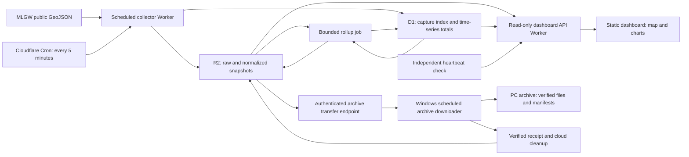

# MLGW outage history and dashboard: design plan

Prepared September 16, 2026. This document proposes an implementation; it does not create cloud resources or start collection.

## 1. Recommended approach

Build a small TypeScript application on Cloudflare: a scheduled Worker collects MLGW's public GeoJSON feed, R2 stores historical snapshots, D1 stores compact time-series summaries, and a static dashboard displays a map and a few charts.

Start with **five-minute collection**, with a configurable one-minute option after measuring the source's actual update frequency. Keep detailed observations indefinitely where practical. Retain them in the cloud while space permits; under storage pressure, transfer detail older than one year to this Windows PC, verify it, and then remove only those verified cloud copies. Keep the newest year in cloud storage and long-term summaries available to the dashboard.

The dashboard will be **accessible to anyone with its link**, with light expected use. **Prioritize $0 recurring cost.** Cloudflare remains the first implementation candidate, subject to storm-load and compression tests. If free Workers compute is insufficient, evaluate free-tier compute alternatives before considering a paid plan; no paid upgrade is assumed.

The useful first version answers:

- How many customers and reported outages are affected now?
- How has that changed over the last day, week, or month?
- Where are the current outages, and what did the map show earlier?
- Which increases, long-running outages, or recurring locations warrant a closer look?

### Confirmed requirements and remaining setup choices

The audience, retention intent, cost priority, and 30-day offline-PC allowance below reflect the user's September 16 clarifications. The work remains a design plan; cloud deployment and Windows-task installation are implementation steps.

| Decision | Requirement or selected approach | Implementation implication |
| --- | --- | --- |
| Audience | Anyone with the link; mostly personal use | No viewer login. Cache public reads, bound traffic, and keep administrative/archive operations authenticated. An unlisted URL does not enforce privacy. |
| History | Preserve detail as long as possible; newest year always in the cloud | Move older detail to the PC only when storage pressure warrants it; verify local receipt before cloud deletion. |
| Cloud provider | No preference; prioritize free | Start by validating Cloudflare; select another free-tier compute option if necessary. |
| Budget | Free-first; no paid compute commitment | Measure compressed annual storage and storm processing before launch; do not enable paid upgrades automatically. |
| Scope | All reported MLGW electric outages; anomalies shown in the dashboard | Automated notifications and weather correlation can follow later. |
| Desktop setup | PC is on irregularly; reserve at least 30 days of offline headroom | Size the reserve from projected storage growth, including storm periods. Select a dedicated archive folder during implementation, such as `%USERPROFILE%\MLGW-Archive`. |

## 2. Source discovery: what is already verified

Direct requests to the live map and its feed succeeded during this planning session. The map itself points to the GeoJSON URL; no login, browser automation, or map-tile extraction was needed.

| Source | Verified observation |
| --- | --- |
| [MLGW outage-map page](https://outagemap.mlgw.org/OutageSummary.php) | Loads `geojson.php` into an ArcGIS GeoJSON layer. Its JavaScript sets a 900-second page-refresh timer. It renders individual features and clusters them in the browser. |
| [MLGW GeoJSON feed](https://outagemap.mlgw.org/geojson.php) | Returns a JSON `FeatureCollection` with point coordinates and outage properties. The inspected response contained 15 features totaling 290 affected customers. This is one observation, not a sizing forecast. |
| [MLGW map description](https://www.mlgw.com/outagemap/) | Describes general outage information across Shelby County, based on reported and known outages; exact address details are deliberately unavailable. |

Observed field mapping:

| Source field | Proposed interpretation |
| --- | --- |
| `OUTAGE_NO` | Source outage identifier; store as a string |
| `CUR_CUST_AFF` | Currently affected customer count |
| `TIME_STAMP` | Reported start time, as labeled by the map popup |
| `EST_REPAIR_TIME` | Estimated restoration time; sometimes empty |
| `DURATION` | Source duration text; preserve, but calculate analytic durations from timestamps |
| `STATUS`, `IMPACT` | Source status and qualitative affected-area description |
| `geometry.coordinates` | Longitude, latitude; preserve the original GeoJSON |
| Feature `id` | Small sequential numbers in the sample; do not use for cross-snapshot identity |
| `OUT_CAUSE` | Present, often blank, and omitted from the map's visible popup; exclude from the initial dashboard |

The sample had no top-level feed update timestamp and no `ETag` or `Last-Modified` response header. The HTML page's “current as of” text must not automatically be treated as the GeoJSON's publication time. The outage host's `robots.txt` returned 404; that does not establish a reuse license.

Before production, check applicable source terms and any published collection guidance, and document the endpoint contract. Use a contactable application User-Agent, low request volume, and backoff. If access becomes restricted, stop and reassess the supported source. No customer-account access is needed.

**Unverified for the current feed:** publication cadence, outage-ID stability/reuse, coordinate precision, and completeness during storms. New-feed history starts with collection. The earlier scraper provides a separate historical source, described below; missing observations cannot be reconstructed.

### Historical evidence from the earlier scraper

Inspected [jpbranson/mlgw.outage.3 at revision `ea0c830`](https://github.com/jpbranson/mlgw.outage.3/tree/ea0c8309337171b398ffadd5d6105d997f9b354b). Analysis used its consolidated R data and the complete current file tree, plus one saved page/event pair. It did not scan every historical Git commit or establish all-time MLGW storm maxima.

| Measurement | Result | Design implication |
| --- | --- | --- |
| Consolidated event records | 1,997,747 rows; 53,274 distinct observation timestamps across 806 dates, February 8, 2022–February 20, 2025 | Existing history can seed storm comparisons; these are repeated event observations, not two million unique outages. |
| Largest recorded affected-customer total | **117,861**, June 26, 2023; 601 reported outages in that observation | Charts and anomaly rules must handle large changes in customer count independently of feature count. |
| Largest recorded outage total | **3,998**, February 8, 2022; 45,382 affected customers | Use about 4,000 current-format features as an observed-scale stress case, plus 10,000 for headroom. |
| Event rows at the largest outage total | 4,094 rows, but 3,998 distinct extracted event identifiers | Legacy imports must deduplicate within a capture and must not use raw row count as the outage total. |
| Recent saved snapshot files | 20,934 files forming 10,467 timestamp pairs, September 11, 2024–February 20, 2025; **38.86 MB combined** | Compressed historical storage is encouraging, but covers a different format and a limited date range. |
| Bytes per recent compressed pair | Mean 3.71 KB; median 3.49 KB; 95th percentile 5.13 KB; maximum 17.95 KB | Compression should be measured early in the new design. These are not new GeoJSON payload estimates. |
| Largest saved page in that recent tree | September 12, 2024: 114,121 bytes of extracted page text, stored as a 12,948-byte RDS; associated page summary: 20,793 customers / 293 outages | A concrete storm fixture for legacy parsing, separate from the larger storms in consolidated history. |
| Filename-based capture spacing in that recent tree | Median 17.2 minutes; 95th percentile 41.1 minutes; about 64% of intervals exceeded 15 minutes | The recorded archive does not deliver consistent 15-minute sampling. This is an observation of stored files, not proof that scheduler delay alone caused every gap. |

Method: extract one unique `(time, outage_num, cust_affected)` summary per timestamp from [`total_outages.rds`](https://github.com/jpbranson/mlgw.outage.3/blob/ea0c8309337171b398ffadd5d6105d997f9b354b/total_outages.rds); never sum its repeated customer totals. For file sizes, pair `.RData` and `_txt.rds` by filename timestamp in the [saved data directory](https://github.com/jpbranson/mlgw.outage.3/tree/ea0c8309337171b398ffadd5d6105d997f9b354b/data). File gaps use local filename times and are approximate around DST. Dates above follow the stored timestamp date; timezone reconciliation is part of import.

The [`total_parsed_polygons.rds`](https://github.com/jpbranson/mlgw.outage.3/blob/ea0c8309337171b398ffadd5d6105d997f9b354b/total_parsed_polygons.rds) file contains 18,906 snapshots with finite spatial coordinates, 127 distinct grid-cell IDs, and coverage dated March 8, 2022–April 27, 2024. Its 154,933 valid snapshot/cell records expand to 774,665 vertex rows. Other rows include missing-coordinate placeholders; those are not extra outages. The latest [scraper source](https://github.com/jpbranson/mlgw.outage.3/blob/ea0c8309337171b398ffadd5d6105d997f9b354b/R/job.R) has polygon processing commented out, so spatial coverage must be audited separately from total-count coverage.

Import this history with `source_format=legacy_html` and preserve its geographic grid polygons. Use `source_format=current_geojson` for new point features. Legacy cell IDs are geographic-area IDs, not current outage IDs; do not turn grid centroids into precise outage locations or distribute grid customer totals among individual events. Show a source-format boundary on charts and do not use old-map observations to train the new-feed anomaly baseline without a comparability check.

## 3. Collection frequency and reliability

Five minutes is a good starting compromise: better than the requested 15-minute resolution, inexpensive, and only 288 feed requests per day. A short source-characterization pilot should measure byte changes, meaningful feature changes, response times, and apparent update intervals over at least 24 hours.

| Poll interval | Polls/day | Polls/30-day month | Polls/365-day year |
| --- | ---: | ---: | ---: |
| 15 minutes | 96 | 2,880 | 35,040 |
| 5 minutes | 288 | 8,640 | 105,120 |
| 1 minute | 1,440 | 43,200 | 525,600 |

Use Cloudflare Cron Triggers, initially `*/5 * * * *`, in UTC. One-minute triggers are supported. The browser does not drive collection. [Cron documentation](https://developers.cloudflare.com/workers/configuration/cron-triggers/)

If source changes occur more frequently than five minutes, consider fixed one-minute polling after checking resource use and source guidance. An optional later mode can poll every minute during elevated activity and every five minutes otherwise; a one-minute trigger with a durable next-due value implements that without repeatedly changing cron configuration.

Polling resolution and information freshness are different. A five-minute collector can repeatedly receive the same source state; faster polling cannot expose changes that MLGW has not published. Outages that begin and end between observations may never be captured.

### Each collection attempt

1. Assign an attempt ID and a UTC scheduled-slot ID. Record actual request and response times separately.
2. Fetch the allowlisted GeoJSON URL with a 15-second timeout and a configurable response-size ceiling. Use conditional headers if the source later supplies validators.
3. Archive the received body and selected response metadata before expensive transformations. Start with uncompressed objects; compression is an optimization to benchmark, not a free-tier assumption.
4. Validate the collection, required identifiers, nonnegative integer customer counts, timestamp parsing, and geometry. Preserve unknown fields in the private raw archive. Flag out-of-area coordinates for review rather than silently losing those outages.
5. Produce a normalized snapshot, totals, and comparisons with the previous valid observation. Store timestamps, validation results, and parser version.
6. Write immutable R2 objects first. Commit the D1 snapshot reference and summaries together only after those objects exist. Advance the latest pointer only if this capture is newer than the current one.
7. Update the cached dashboard result. Record failures without converting them into zero outages.

Use a short expiring lease to prevent overlapping collectors. Make slot publication idempotent, keep retry attempts as separate records, and tolerate orphaned R2 objects after a failed database commit. Retrying publication must not double-count a snapshot. A recovery pass can find archived but unprocessed captures and process them later with their original observation times.

Retry transient network/5xx failures at most twice with jitter inside a bounded run. Honor `Retry-After` for 429 responses, even if that means skipping scheduled slots. A delayed run captures the current state at its actual retrieval time; it must never pretend to backfill the earlier scheduled instant.

Track two independent health measures: **last successful retrieval** and **evidence of source freshness**. Identical content alone is not evidence of failure. With no reliable source timestamp, show “retrieved at” and “source update time unavailable.” Flag collection gaps above 10 minutes and display a clear stale-data banner at 15 minutes. Use an independent heartbeat check so a stopped scheduler can be detected.

## 4. Cloud architecture



Use two Worker deployments in one repository: a collector and a dashboard/API. This separates ingestion from viewer requests, although account-level free quotas remain shared. A small scheduled maintenance job builds rollups incrementally from newly accepted snapshots, with a durable processing cursor.

Serve the frontend with Workers Static Assets. Static-asset requests are free and unlimited; API requests execute Worker code and consume its allowance. Use the supplied `workers.dev` hostname initially to avoid a domain purchase. [Static asset billing](https://developers.cloudflare.com/workers/static-assets/billing-and-limitations/), [Workers hostnames](https://developers.cloudflare.com/workers/configuration/routing/workers-dev/)

The dashboard and its bounded read-only API are public without login. Keep R2 buckets private and expose only selected normalized data through the API. Archive transfers, receipts, cleanup, and administrative controls require separate machine authentication and must never share the public cache. The collector needs no public HTTP ingestion route. A `noindex` directive can discourage search indexing, but the link remains publicly accessible.

### Alternatives considered

| Option | Assessment |
| --- | --- |
| Cloudflare Workers + R2 + D1 | Recommended for a small integrated deployment with inexpensive retained history. Free compute is the main constraint. |
| AWS EventBridge Scheduler + Lambda + object storage | Evaluate before paid Workers if storm parsing/compression exceeds free CPU. Published allowances include 14 million scheduler invocations and 1 million Lambda requests / 400,000 GB-seconds per month. Storage, requests, logs, hosting, egress, and account-plan eligibility still need budgeting; this is not an end-to-end $0 guarantee. Keep the collector/parser portable. Using Lambda with Cloudflare storage is also possible, but adds authenticated transfer and AWS outbound-transfer accounting. |
| GitHub Actions as the collector | Suitable for tests and deployments, but unsuitable as the primary sampling clock: scheduled jobs can be delayed or dropped and the minimum interval is five minutes. Public-repository schedules can also be disabled after inactivity. |

Sources: [AWS Scheduler pricing](https://aws.amazon.com/eventbridge/pricing/), [Lambda pricing](https://aws.amazon.com/lambda/pricing/), [GitHub schedule behavior](https://docs.github.com/en/actions/reference/workflows-and-actions/events-that-trigger-workflows#schedule).

## 5. Storage and data model

Keep large, repeating spatial records in R2. Avoid writing one D1 row for every active outage on every poll: 1,000 simultaneous outages at five-minute intervals would produce 288,000 feature rows per day before indexes, exceeding D1's free write allowance.

### R2 object layout

```text
raw/YYYY/MM/DD/<attempt-id>.geojson
metadata/YYYY/MM/DD/<attempt-id>.json
normalized/YYYY/MM/DD/<snapshot-id>.geojson
manifests/YYYY/MM/DD.json
rollups/hourly/YYYY/MM/DD.json
rollups/daily/YYYY/MM.json
```

Raw bodies are immutable. Normalized snapshots contain a stable, explicitly allowed set of fields for the dashboard, plus provenance. Daily manifests connect every accepted timestamp to its snapshot and record failed/missing slots. Byte-identical responses may share an archived payload, but each successful observation still has a timestamped manifest entry. Do not mistake a change in `DURATION` alone for a new outage event.

### D1 tables

| Table | Essential columns and purpose |
| --- | --- |
| `poll_attempts` | Attempt ID, scheduled slot, actual capture time, HTTP status, bytes, latency, archive key, parse outcome, error category |
| `snapshots` | Snapshot ID, unique accepted slot, capture time, optional source update time, raw/normalized object keys, hash, valid/invalid feature counts, quality flags, parser version |
| `totals` | Snapshot ID, outage-feature count, affected customers, new/disappeared reported events, coverage/comparability flags |
| `rollups` | Bucket start, resolution, customer-minute estimate, covered minutes, mean/peak customers, peak outage count, anomaly summaries |
| `collector_state` | Lease, latest committed snapshot, next-due time if needed, maintenance cursor |

Index capture time and bucket time; use primary/unique keys for idempotency. Keep indexes few and queries bounded. Query metadata must include the observation time and coverage, not just numeric totals.

Initially retain D1 capture indexes and full-resolution totals for one year, attempts for 30 days, and compact hourly/daily totals longer. At one-minute collection or approaching 350 MB, archive older capture indexes/totals into R2 manifests and shorten D1's hot window to 90 days. Historical maps remain accessible through date manifests. Store spatial rollups as R2 files rather than an indefinitely growing cell-by-time D1 table.

Keep raw and normalized detail in the cloud beyond one year while capacity permits. Do not apply an unconditional one-year expiration rule. Under storage pressure, use the verified desktop handoff below; preserve complete detail somewhere even when it leaves the cloud. D1's free recovery window is seven days, so it is not a substitute for durable archives. [D1 limits](https://developers.cloudflare.com/d1/platform/limits/)

### Automatic archiving to this PC

Implement the requested cloud-to-desktop transfer as a **desktop-initiated download**. A Windows Scheduled Task contacts the cloud over outbound HTTPS, so the PC needs no public address, open inbound port, or always-running web server. Run daily, resume after missed runs when the PC is available, and prevent overlapping executions. Installation and the target folder are later implementation tasks.

The archive preserves original payloads, normalized geometry/properties, UTC observation metadata, schema/parser versions, quality flags, and per-file SHA-256 checksums. Use portable daily or monthly bundles with a manifest, bounded part sizes, and a small local SQLite catalog. A source-to-bundle index preserves every retained observation even when repeated bodies are deduplicated. Retain long-term chart summaries and the archive catalog in the cloud.

Transfer protocol:

1. Predict storage use from measured recent growth and storm scenarios. Trigger preparation at 70% of the available R2 free storage budget, begin offloading older-than-one-year detail at 80%, and flag urgent pressure at 90%. Start earlier if needed to retain at least 30 days of projected incoming data plus transfer staging and cleanup-grace capacity. Subtract other account usage; these percentages are targets, not provider-enforced caps.
2. Select oldest eligible UTC date partitions only when every observation in them is strictly older than the current instant minus one calendar year. The plan does not permit moving the protected year out of cloud storage.
3. The PC checks available disk space, downloads immutable parts into `.partial` files, resumes interrupted transfers, checks byte counts and SHA-256, and verifies that the bundle can be read. Write the completed manifest/catalog atomically only after every part is verified.
4. The PC sends an authenticated receipt identifying the manifest version, object list, hashes, and completed local verification. A narrowly scoped machine credential lives in Windows-protected credential storage, never in the public dashboard.
5. The cloud records the receipt. After a seven-day grace period and a second successful local verification, the cleanup job rechecks age eligibility and removes only the receipted cloud detail. Keep manifests and summaries. Deduplicated payloads referenced by the protected year cannot be deleted.
6. After handoff, the public dashboard identifies that date's detailed map as archived to the owner’s PC. It continues to show cloud summaries. The owner can inspect full detail locally or explicitly restore selected bundles to the cloud for sharing; the public page does not connect to this desktop.

Use idempotent receipts, immutable manifest IDs, and a per-part cleanup journal so retries or partial deletion cannot lose unacknowledged files. Export D1-only observation metadata before its cloud rows are pruned. Do not count an R2 ETag as a universal file checksum. Test a restore from the actual downloaded bundle before first enabling cleanup.

The PC is on irregularly, so **30 days of offline headroom is a confirmed requirement**. If it is off, disconnected, full, or has failed verification, leave the cloud copies intact, retry when it becomes available, and show archive-backlog/last-receipt status. Size the reserve from measured storage growth and storm scenarios, with additional room for transfer staging and the deletion grace period. Forecast pressure early enough to preserve that reserve. A verified single-PC archive remains vulnerable to disk loss; a second local/external-drive copy is advisable where available.

There is a real capacity boundary: offloading data older than a year cannot help if the newest year alone exceeds free storage, or if the PC stays unavailable beyond the reserve. Measure this before launch. Compress/deduplicate first, prefer five-minute over one-minute collection if needed, and evaluate other free capacity before paid service. If the requirements no longer fit, surface the storage/cadence decision rather than silently deleting the protected year, losing old detail, or promising unlimited free retention.

## 6. Time, outage identity, and spatial meaning

Store observation times as UTC instants; display them in `America/Chicago`. Source date strings lack an explicit offset. Preserve them verbatim and provisionally interpret them in `America/Chicago`, recording that assumption. Use an explicit format/time-zone parser, not JavaScript's implicit date parsing. Ambiguous fall-back DST times should carry an ambiguity flag rather than an invented precise instant.

Use `(OUTAGE_NO, reported start time)` as a provisional event key. Test its stability across the pilot. If a start time is corrected or an ID disappears and reappears, retain the source observations and mark identity uncertain; do not silently invent a new confirmed event or merge unrelated incidents.

An outage disappearing from a complete snapshot means **no longer reported**, not a confirmed restoration. Optionally confirm disappearance on the next valid snapshot, but retain the first-absence observation time. Invalid/incomplete captures cannot close outages. The interval between last seen and first absent bounds the observed disappearance; actual restoration time remains unknown. Duration statistics should distinguish source-reported start time, first observation, last seen, first absent, and still-active events.

Validate GeoJSON coordinate order as `[longitude, latitude]` and normalize for the mapping library at the boundary. Preserve original point geometry and precision. These points are approximate reported locations; they are not customer addresses or outage-boundary polygons. If the feed later changes geometry type, archive it and flag the schema change before publishing unsupported geometry.

For spatial trends, aggregate reported point locations into a versioned grid of roughly 1 km cells, with consistent projected boundaries. Store the grid definition once. Label results as “reported outage activity near this location.” Do not infer service areas from marker circles or claim all affected customers reside inside a point's grid cell. Neighborhood/ZIP summaries can follow if trustworthy boundaries are selected; counts without customer-population denominators are not neighborhood reliability rates.

## 7. Trends and anomaly detection

Start with transparent rules and aggregate statistics. Machine learning is unnecessary for the first version.

| Metric | Method and interpretation |
| --- | --- |
| Affected customers | Sum valid `CUR_CUST_AFF` values within one snapshot; never sum snapshots and call that unique customers |
| Active reported outages | Count source features, separate from affected customers and browser clusters |
| Change over time | Difference between comparable valid observations; suppress event comparisons across gaps or suspect snapshots |
| Customer-minutes | Integrate affected-customer counts over observed time; an estimate of interruption burden, not an official utility metric |
| Geographic recurrence | Count distinct provisional events by reported-location cell; separate frequency from duration and affected-customer burden |
| Restoration progress | Falling affected-customer totals during a selected period, without assuming every decrease is a verified restoration |

For customer-minutes, use a left-step estimate `sum(customers_i * elapsed_minutes_i)` between consecutive valid observations no more than 1.5 configured poll intervals apart. Split contributions at rollup boundaries. Longer gaps contribute unknown time, not zeros. Report covered minutes and coverage percentage alongside daily/hourly estimates; avoid extrapolating a partial day to a whole day. End the estimate at the last observation.

Initial anomaly rules, with configurable thresholds:

- **Sharp increase:** at least 100 additional affected customers and at least double the prior comparable count within 10 minutes. Treat a rise from zero using the absolute threshold. Mark this as a heuristic.
- **Unusually high activity:** after 28 sufficiently observed days, compare the current count with a robust baseline from the preceding 28 days. Use one valid observation per five-minute baseline slot so faster storm polling does not overweight storm periods. Flag counts above the median plus the larger of 100 customers or six scaled median absolute deviations. Require at least 90% baseline coverage and handle zero spread with the absolute floor. Persist baseline/rule versions.
- **Long-running reported outage:** highlight a source-reported duration above six hours, with ambiguous/missing start times clearly labeled.
- **Recurring location:** rank grid cells by distinct reported events and estimated burden over 7/30 days. Present rankings initially; avoid a statistically confident hotspot claim from sparse history.

Separate source/data-quality anomalies from electrical-outage anomalies. Unexpected schema changes, duplicate IDs, invalid geometry, and a sudden empty collection after a large outage are data-quality signals. Preserve suspect captures and show the last trustworthy state with a warning. Confirm a suspicious zero using subsequent captures and, when useful, the separately retrieved HTML summary; do not permanently reject legitimate recovery to zero. Store each source's retrieval time because the two requests are not atomic.

Do not publish SAIDI/SAIFI or unique households affected from this feed. Those require identities, denominators, and interruption histories that these public snapshots do not establish.

## 8. A deliberately small dashboard

Use plain TypeScript with a small build setup, [Leaflet for GeoJSON maps](https://leafletjs.com/examples/geojson/), and [Chart.js for time-series charts](https://www.chartjs.org/docs/latest/). Keep the initial UI to one responsive page:

1. A freshness line and cards for affected customers, active reported outages, change, and daily peak.
2. A map and time slider. Start at the latest accepted capture; allow selecting an actual historical observation. Size markers by affected customers and show start/status/repair estimate in a popup.
3. One main line chart with customers/outage-count toggle, 24-hour / 7-day / 30-day presets, visible gaps, and anomaly markers.
4. A small list of long-running outages or recurring-location rankings, plus CSV/GeoJSON export for the selected bounded period.

Selecting a chart point updates the map to that observation when its detail is cloud-resident. Show the exact selected timestamp and avoid blending “latest” cards with an older map. Use five-minute observations for short ranges and hourly/daily summaries for long ranges, preserving bucket peaks so short spikes remain visible. Load an older map on demand; do not download an entire year of features to the browser. For PC-only detail, display its archive status and available summary instead of an empty map or a fabricated point layer. Legacy maps use the old grid representation and carry a visible source-format label.

The map library and basemap tiles are separate dependencies. For a small personal pilot, standard OpenStreetMap tiles may be used subject to its visible attribution, referrer, and caching requirements. Do not bulk-download or prefetch tiles. Keep the tile provider configurable and let the outage layer remain usable if tiles are unavailable. Reassess the basemap for public traffic. [OSM tile policy](https://operations.osmfoundation.org/policies/tiles/)

Proposed read-only API:

```text
GET /api/latest
GET /api/series?from=...&to=...&resolution=...
GET /api/snapshots?date=YYYY-MM-DD
GET /api/snapshot/<snapshot-id>
GET /api/spatial-summary?from=...&to=...
GET /api/health
```

Validate date ranges, cap response sizes, and require a coarse resolution for long chart ranges. Cache current responses briefly (about 60 seconds) and immutable snapshots longer. Return source attribution, quality flags, and capture times consistently. Escape source strings in popups. Keep database bindings, storage credentials, and administrative operations out of the browser.

## 9. Cost and capacity estimates

Prices below were checked against provider documentation on September 16, 2026. Allowances are shared with other applications in the account and may change.

| Service | Relevant allowance or price |
| --- | --- |
| Workers Free | 100,000 requests/day; 10 ms CPU per invocation, including scheduled invocations |
| Workers Paid, comparison only | $5/month minimum; a cron running more often than hourly has a 30-second CPU limit; not selected under the free-first preference |
| D1 Free | 5 million rows read/day; 100,000 rows written/day; 5 GB account storage, but only **500 MB per database** |
| R2 Standard | 10 GB-month storage, 1 million Class A operations/month, and 10 million Class B operations/month included; additional storage $0.015/GB-month; no egress charge |

Sources: [Workers pricing](https://developers.cloudflare.com/workers/platform/pricing/), [CPU limits](https://developers.cloudflare.com/workers/platform/limits/), [D1 pricing](https://developers.cloudflare.com/d1/platform/pricing/), [D1 size limits](https://developers.cloudflare.com/d1/platform/limits/), [R2 pricing](https://developers.cloudflare.com/r2/pricing/).

CPU is the key free-tier risk: parsing, hashing, normalization, compression, and serialization count; waiting for network I/O does not. Reducing polling frequency does not solve a per-invocation CPU overrun. Test ordinary current-format payloads, roughly 4,000 features based on the legacy outage peak, and 10,000 features for headroom on the deployed runtime. Customer totals of 117,861 do not imply 117,861 separate features. A free pilot must retain meaningful headroom below the limit rather than depending on occasional tolerated overruns.

At five-minute collection, even six R2 writes per poll are only 51,840 writes per 30-day month before maintenance. A design using at most 20 billed D1 writes per poll would consume about 5,760/day. Measure actual `rows_written`, including index maintenance and cleanup; a database batch does not turn many changed rows into one billed write. Viewer queries and rollups also consume resources.

Storage sizing should use **combined bytes per poll**, including raw data, normalized data, manifests, and attributable rollups. The following are scenarios, not measurements; decimal KB/GB are used, with no assumed compression or deduplication savings.

| Combined archived bytes/poll | One year at 5 minutes | One year at 1 minute | Approx. monthly R2 storage charge at that retained volume: 5 min / 1 min |
| --- | ---: | ---: | ---: |
| 25 KB | 2.63 GB | 13.14 GB | $0 / $0.06 |
| 100 KB | 10.51 GB | 52.56 GB | $0.02 / $0.65 |
| 1 MB | 105.12 GB | 525.60 GB | $1.44 / $7.74 |

Formula: `annual_GB = bytes_per_poll * polls_per_year / 1,000,000,000`. Storage charges apply to the monthly stored volume above the included allowance, with provider rounding. The table describes the volume after a year; the first year grows gradually. Cloud retention beyond a year grows until older detail is offloaded. Request overages, taxes, domains, paid compute, and optional services are excluded. R2 operations for bundle staging, verification reads, and desktop downloads must also be counted, although R2 egress itself is free.

For illustration, a 10 GB free allowance with 2 GB reserved leaves a protected-year budget of **about 76 KB per five-minute observation**, including compressed raw/normalized data and its share of metadata/rollups. At one-minute polling that falls to about **15 KB**. The actual reserve must cover at least 30 days of projected incoming data, storm scenarios, transfer staging, and cleanup grace; do not assume 2 GB automatically meets that requirement. Other account storage reduces both budgets. The old 3.71 KB mean compressed pair is encouraging, but cannot establish either new-feed target: map format, storm exposure, capture frequency, and normalization differ. Measure new-format compression and duplication during the pilot, and include a multi-day 4,000-feature storm in the annual-growth model.

R2 requires a subscription checkout and bills usage above its allowance; “free tier” is not a hard spending cap. [R2 setup](https://developers.cloudflare.com/r2/get-started/)

Set usage alerts at 70% and 90%, bound public queries/exports, shorten diagnostic-log retention, and review storage growth after the pilot. Cache immutable history and recent series to protect the shared free API/database quotas, and enforce public request budgets so unexpected traffic cannot consume ingestion capacity unchecked. Prefer reducing viewer/maintenance load before collection. A free-first target is not a provider spending cap: keep R2's usage-based billing visible and trigger the desktop process early. Do not silently drop history or downgrade to intervals longer than 15 minutes.

## 10. Implementation sequence and acceptance criteria

### Phase 1: establish the source contract

**Current execution scope:** on September 16, 2026, the user directed validation to remain local for now. Complete the local observation, parsing/replay, stress and storage checks, then report back. Defer cloud account setup, deployment and provider-runtime validation until requested. The cloud exit criteria below remain unverified and are not prerequisites for reporting the local checkpoint.

**Execution started September 16, 2026:** see [Phase 1 status and measurements](reports/PHASE1_STATUS.md). The five-minute, 24-hour local observation pilot is running. Local storm benchmarks flag a CPU risk for an ordinary free Worker and insufficient storage margin when both raw and normalized history are retained permanently. A free Durable Object compute option and compressed originals with a 48-hour normalized cache are the revised candidates; the latter models at 5.47 GB including the 10,000-feature reserve case and passes local byte-exact replay checks. Cloud validation is pending. Phase 1 is not yet accepted; the user's subsequent request to proceed authorized local Phase 2 implementation while these observations continue.

- Capture representative fixtures and measure feed updates for at least 24 hours at five-minute intervals.
- Verify source field meanings, timezone assumptions, ID stability, and completeness checks; compare the feed total with the HTML summary using independently recorded times.
- Measure payload bytes, compression, and Worker CPU on ordinary, 4,000-feature, and 10,000-feature inputs. The first stress case reflects the observed legacy peak; the larger is a headroom probe, not a prediction of maximum storms.
- Confirm that the protected year plus at least 30 days of offline-PC headroom, transfer staging, and cleanup grace fits free storage under the chosen cadence and storm model. Evaluate free-tier compute alternatives if Workers fails its CPU target.
- Select the archive directory/disk capacity and five- versus one-minute cadence. Audience, indefinite-detail intent, free-first priority, and irregular PC availability with 30 days of headroom are already settled.

**Exit:** the selected free-tier runtime can archive and process the supported payload range with headroom, and a year's storage fits the measured free budget with archive reserve. If either fails, revise the free architecture/cadence before selecting a paid option. The $0 design is not accepted solely because a quiet-day sample works.

### Phase 2: durable collection

**Local execution started September 16, 2026:** see [Phase 2 status](reports/PHASE2_STATUS.md). Immutable gzip archives, parser-version replay, a compact SQLite index, leases/retries, bounded rollup maintenance and freshness/pressure reporting are implemented with 34 passing tests. A seven-day local trial is running and reuses Phase 1 captures until that pilot ends. Cloud adapters, deployments and the full seven-day acceptance criteria remain unverified; the user's local-only constraint still applies.

- Implement versioned parsing, immutable R2 capture, D1 summaries, idempotency, bounded retries, and freshness reporting.
- Deploy separate development and production resources with environment-specific bindings and narrow deployment credentials.
- Add incremental rollups, pressure-based retention configuration, and a replay path for archived captures. No unconditional one-year expiration.
- Run a seven-day collection pilot before relying on the service.

**Exit:** target at least 99% successful scheduled observations while the source is reachable, with no unexplained gap over 15 minutes. Report all gaps and source failures separately; this is an operating target, not a free-hosting SLA.

### Phase 3: dashboard and descriptive analysis

**Local implementation completed September 16, 2026:** see [Phase 3 status](reports/PHASE3_STATUS.md). The loopback dashboard provides linked historical maps/cards/charts, bounded exports, explained anomaly rules and coverage indicators, with 45 passing tests and desktop/mobile-viewport checks. It reads the active local archive while the earlier pilots continue. The user requested a check-in after this step. Public cloud serving/authentication and provider validation remain deferred; Phase 4 has not started.

- Build the one-page dashboard, time-linked map/chart, historical retrieval, and bounded exports.
- Add the simple anomaly rules with visible explanations and coverage flags. Enable the robust baseline only after enough history exists.
- Keep viewer access public and verify that archive/admin authentication cannot be bypassed by public routes or cached responses.

**Exit:** selecting a cloud-resident timestamp reproduces its archived spatial state and totals; charts display failures as gaps; a desktop and mobile browser can use the page without downloading unbounded history.

### Phase 4: legacy history and desktop retention

- Import deduplicated legacy total-count observations and supported grid snapshots through a separate versioned adapter. Preserve original RDS/RData files and provenance; do not run the old scraper or copy its credentials/configuration into the new deployment.
- Populate historical storm comparisons with the measured 2022–2025 observations, explicitly marking gaps, unavailable geometry, and source-format differences. Do not assume the current checkout contains every older raw file referenced by the consolidated data.
- Install the Windows archive downloader, receipt protocol, cloud archive catalog, and pressure-triggered cleanup. Keep detailed historic maps available in the cloud while capacity permits.
- Exercise offline/resumed downloads, a full disk, corrupted parts, duplicate receipts, protected-year boundaries, and restoration of a transferred historical map before enabling cloud cleanup.

**Exit:** every removed cloud payload has a verified, readable desktop copy; the newest year stays cloud-resident; public charts retain long-term summaries and accurately identify PC-only detail.

### Required verification

- Parser fixtures: empty valid feed, malformed JSON, missing/blank fields, duplicate IDs, invalid counts/coordinates, and schema changes.
- Time fixtures: explicit source format, Central daylight/standard time, ambiguous DST values, and missing restoration estimates.
- Pipeline cases: repeated slot, overlapping/delayed run, 429 backoff, failed R2 write, failed D1 commit, raw capture awaiting processing, and replay without double-counting.
- Analytics cases: unchanged observations, genuine zero, suspicious empty feed, an outage disappearing/reappearing, partial coverage, and correct customer-minute bucket boundaries.
- Operational checks: storm-size resource use, cost telemetry, stale-data banner and heartbeat detection, public-read quota protection, and a restore/replay exercise from archived data.
- Retention checks: desktop offline for 30 days under the storage-growth model, successful catch-up after it returns, partial downloads/deletions, checksum mismatch, expired machine credentials, payloads shared with protected observations, and preventing cleanup without a matching verified receipt.

Future additions should be driven by use: one-minute storm collection, weather overlays, better geographic comparisons, or notifications. Indefinite detailed retention with verified desktop offload is part of the planned system, not an optional future extension. Preserve the small dashboard and reliable collection path as the core of the project.
