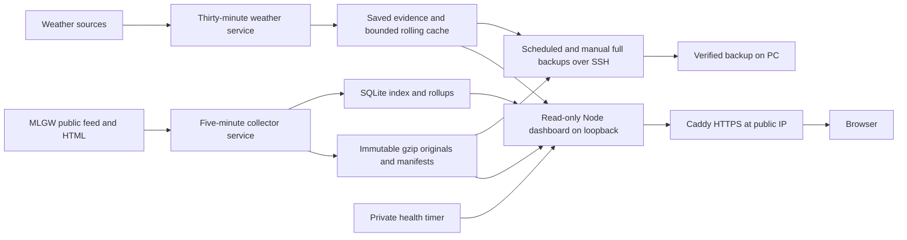

# 4. Deployed cloud architecture

One DigitalOcean Ubuntu VM runs the existing Node/filesystem/SQLite application. Separate systemd services isolate the outage collector, rolling weather refresh and read-only dashboard. Caddy terminates HTTPS at the selected public IP and proxies the dashboard on loopback. A health timer checks observation/weather freshness, runner heartbeats, storage pressure, free disk space and a verified PC backup no older than 36 hours; a separate timer renews the IP certificate.

The public dashboard has no viewer login and exposes only allowlisted reads. Canonical raw archives, administrative operations and backup downloads are not public routes; administration uses SSH. Runtime services use the unprivileged `mlgw` account and dedicated writable directories. The dashboard's canonical archive mount is read-only, with write access retained only where SQLite WAL coordination requires it. Data routes have per-client and aggregate limits; `/api/health` remains available under quota pressure, and `/api/ready` returns 503 when current observations are unhealthy. Credentials and local trial state were excluded from deployment bundles.

The production collector has no trial deadline, restarts after failures and resumes its recorded schedule. Source restrictions, operator stop markers and urgent storage stops require review and survive service restarts. The two local PC collectors are stopped, so only the VM polls upstream sources. The installed Windows task downloads and verifies full backups daily and at login. External notifications remain unconfigured by choice, and automatic deletion of canonical history remains disabled.

## Alternatives considered

The original September 16 proposal used Cloudflare Workers/Durable Objects, R2 and D1. It was not deployed, and its provider-specific compute/storage gates are not claims about this VM. The [prepared Cloudflare probe](../operations/cloudflare-probe.md) and dated [cost model](cost-and-capacity.md#historical-cloudflare-comparison--september-16) remain reference material. AWS serverless compute was also considered; GitHub Actions was rejected as the primary sampling clock. The selected VM preserves the already-validated filesystem/SQLite implementation.
